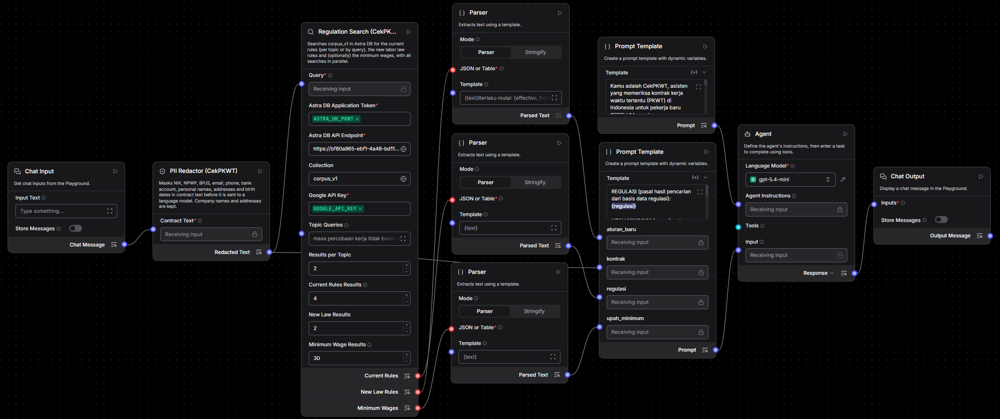
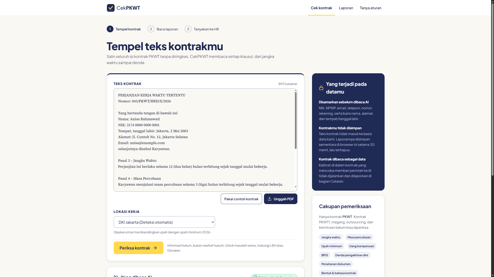
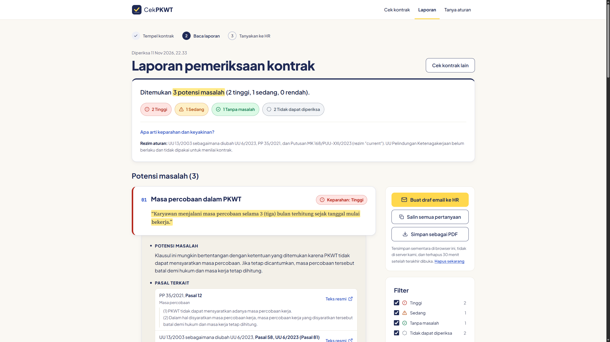
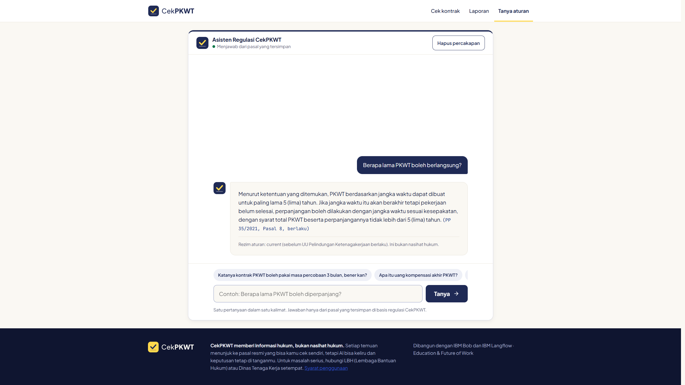

<p align="center"></p>

<p align="center"><b>Cek dulu, baru tanda tangan.</b><br>AI pemeriksa kontrak kerja waktu tertentu (PKWT) untuk fresh graduate, sebelum kontrak ditandatangani.</p>

CekPKWT membaca kontrak PKWT, menyamarkan data pribadi, lalu membandingkan setiap klausul dengan pasal dari korpus regulasi resmi. Hasilnya laporan potensi masalah: pasal rujukan, tingkat keparahan, tingkat keyakinan, dan pertanyaan sopan untuk HR. Seluruh logikanya berjalan di **IBM Langflow** dan bisa dipakai lewat **web app** (tanpa akun) maupun **IBM Bob** (lewat MCP).

| | |
|---|---|
| **Coba langsung** | https://cek-pkwt.briantedjo.my.id (gratis, tanpa akun) |
| **Video pitch** | https://youtu.be/bPG3masozO4 |
| **Video demo** | https://youtu.be/n3jga_MC9AM |
| **Tema** | Education & Future of Work |
| **Teknologi IBM** | IBM Langflow (seluruh logika, MCP server) dan IBM Bob (antarmuka percakapan, MCP client) |
| **Tim** | Brian Nich ([@britoddd](https://github.com/britoddd)) dan Joel Chriscendo ([@Joelcrl](https://github.com/Joelcrl)) |

> ⚠️ **Bukan nasihat hukum.** Hasil CekPKWT dibuat oleh AI dari basis regulasi yang terbatas dan bisa keliru. Untuk masalah serius, hubungi LBH atau Dinas Tenaga Kerja setempat.

## Ringkasan proyek

| Aspek | Bukti utama | Bagian |
|---|---|---|
| Kejelasan dan relevansi masalah | Pengangguran usia 15–24 tahun 16,89%, tiga kali angka nasional. 884 aduan Lapor Menaker dalam 8 hari, terbanyak soal hubungan kerja dan upah. UU ketenagakerjaan sedang berganti. | [1. Masalah](#1-masalah) |
| Inovasi, kelayakan, dan monetisasi | Korpus yang sadar status dan rezim aturan, diperbarui bot setiap hari dengan tinjauan manusia. Sudah berjalan di produksi. Gratis bagi pekerja, dibiayai lisensi institusi. | [2. Solusi](#2-solusi-inovasi-dan-kelayakan) |
| Dampak bagi pengguna | Pada satu kontrak contoh, lebih dari Rp12 juta hak upah dan kompensasi dipertaruhkan. Tindak lanjut ke HR lewat email atau WhatsApp. | [3. Dampak](#3-dampak-bagi-pengguna) |
| Eksekusi teknis | Satu Langflow melayani IBM Bob, web app, dan CI. 79% masalah tertanam terdeteksi, 98% rujukan ada di korpus, 6 dari 6 suite uji lulus. Model dipilih lewat perbandingan di server. | [4. Eksekusi teknis](#4-eksekusi-teknis) |
| Responsible AI | Data pribadi disamarkan sebelum sampai ke LLM, setiap temuan menunjuk ke pasal, agent tidak bisa mengirim email, dan perubahan korpus wajib ditinjau manusia. | [5. Responsible AI](#5-responsible-ai) |
| Demo dan identitas | Video pitch dan demo, alur demo 3 menit dengan kontrak contoh, dan identitas brand yang konsisten. | [6. Demo dan identitas](#6-demo-dan-identitas) |

## 1. Masalah

Fresh graduate biasanya menandatangani kontrak PKWT pertama dalam waktu singkat, tanpa tahu klausul mana yang mungkin bertentangan dengan aturan: masa percobaan pada PKWT, upah di bawah upah minimum, uang kompensasi yang ditiadakan, denda pengunduran diri, atau ijazah yang ditahan. Kerugiannya baru terasa setelah tanda tangan, saat posisi tawar pekerja sudah hilang.

| Fakta | Sumber | Artinya |
|---|---|---|
| Pengangguran usia 15–24 tahun **16,89%**, lebih dari tiga kali angka nasional **4,85%**. | BPS, Agustus 2025 ([detikEdu](https://www.detik.com/edu/detikpedia/d-8268287/bps-7-46)) | Persaingan pekerjaan pertama ketat, jadi pelamar enggan menawar dan langsung tanda tangan. |
| **56,4%** penerima Bantuan Subsidi Upah 2020 adalah pekerja kontrak. | Kemnaker, TNP2K, BPJS Ketenagakerjaan ([CNN Indonesia](https://www.cnnindonesia.com/ekonomi/20210819190342-532-682646/survei-mayoritas-penerima-blt-gaji-2020-pekerja-kontrak)) | Kontrak waktu tertentu umum di kelompok berupah rendah. |
| Lapor Menaker menerima **884 aduan** dalam 8 hari: 441 soal hubungan kerja, 427 soal pengupahan. | [detikNews](https://news.detik.com/berita/d-8220766/layanan-lapor-menaker-terima-884-aduan-ini-jenis-pelanggarannya) | Topik aduan terbanyak adalah topik yang diperiksa CekPKWT, tetapi aduan baru masuk setelah masalah terjadi. |
| Menaker melarang penahanan ijazah lewat **SE M/5/HK.04.00/V/2025** karena kasusnya marak. | [CNBC Indonesia](https://www.cnbcindonesia.com/news/20250520162331-4-634752/resmi-perusahaan-dilarang-tahan-ijazah-dan-dokumen-pribadi-karyawan) | Klausul seperti ini benar-benar muncul di kontrak. |

**Mengapa mendesak sekarang**

1. **Undang-undangnya berganti.** Putusan MK 168/PUU-XXI/2023 mengubah pasal PKWT di UU Cipta Kerja, dan DPR mengesahkan UU Pelindungan Ketenagakerjaan pada 6 Oktober 2026 ([Bloomberg Technoz](https://www.bloombergtechnoz.com/detail-news/123736/dpr-resmi-sahkan-ruu-pelindungan-ketenagakerjaan)). Pekerja perlu tahu aturan mana yang berlaku hari ini.
2. **Aturan turunannya terus terbit.** Pada hari pertamanya, bot CekPKWT menemukan PP 49/2025 (Pengupahan) dan Permenaker 7/2026 (Alih Daya). Pengetahuan chatbot umum cepat usang.
3. **Upah minimum berubah setiap tahun** dan berbeda per wilayah.

**Celah pada cara yang ada:** aturannya tersebar di UU, PP, keputusan gubernur, surat edaran, dan putusan MK; sumber di internet jarang menyebut apakah pasal masih berlaku; pengacara terlalu mahal, bertanya ke HR terasa canggung, dan kanal pengaduan baru bekerja setelah masalah terjadi.

**Mengapa AI, dan mengapa AI yang dibatasi.** Kontrak ditulis bebas, jadi checklist kaku tidak cukup untuk membacanya. Namun penilaian hukum tidak boleh dikarang. CekPKWT memakai LLM untuk *memahami* kontrak, sedangkan *penilaiannya* diambil dari pasal resmi (retrieval-augmented generation). Klausul tanpa pasal pendukung masuk ke "Tidak dapat diperiksa".

## 2. Solusi, inovasi, dan kelayakan

### Cara kerja

1. Pengguna menempelkan teks atau mengunggah PDF kontrak di web app (PDF dibaca di browser dan tidak pernah dikirim), atau menempelkannya di IBM Bob. Data pribadi disamarkan, dan web app menampilkan pratinjaunya sebelum mengirim. Lokasi kerja dikenali otomatis dari kontrak dan bisa diubah pengguna.
2. Agent di Langflow mengekstrak klausul, mengambil pasal dan upah minimum yang relevan, lalu menyusun laporan yang diurutkan menurut keparahan. Di web app, temuan bisa difilter menurut keparahan dan dibuka per detail, semua pertanyaan untuk HR bisa disalin sekaligus, dan laporan bisa disimpan sebagai PDF atau dihapus kapan saja. Setiap pasal rujukan tertaut ke dokumen resminya, dan setiap temuan punya tombol **Laporkan kesalahan**.
3. Pengguna bertanya lebih lanjut di **Tanya aturan** (dengan contoh pertanyaan siap kirim; pertanyaan berbahasa Inggris dijawab dalam bahasa Inggris), lalu mengubah temuan menjadi pertanyaan untuk HR yang ia kirim sendiri lewat Gmail, aplikasi email, atau WhatsApp.

### Yang baru

1. **Korpus yang sadar status dan rezim aturan.** Setiap pasal ditandai status (`berlaku`, `diubah`, `dimaknai_putusan_mk`, `belum_berlaku`, …) dan rezim (`current` atau `uu_pk_2026`). Saat UU baru berlaku, peralihannya cukup berupa perubahan data.
2. **Korpus yang memperbarui diri, dengan manusia sebagai penentu.** Bot harian membaca JDIH dan putusan MK, mengunduh PDF resmi, dan menolak teks yang tidak ada kata per kata di PDF. Hasilnya menjadi pull request yang wajib ditinjau manusia.
3. **Privasi sebelum model.** NIK, NPWP, email, telepon, rekening, nama, alamat, dan tempat/tanggal lahir disamarkan sebelum teks sampai ke LLM. Kontrak tidak pernah disimpan ke basis data vektor.
4. **Dari temuan ke tindakan.** Setiap temuan membawa pertanyaan untuk HR yang sopan dan tidak menuduh.
5. **Satu otak, banyak pintu.** Flow Langflow yang sama melayani IBM Bob, web app publik, dan CI, sehingga prompt dan logika hanya dipelihara di satu tempat.

| Cara saat ini | Kelemahan | CekPKWT |
|---|---|---|
| Membaca sendiri atau bertanya ke teman | Tidak tahu aturan mana yang berlaku | Setiap klausul dicocokkan dengan pasal yang bisa dicek |
| Chatbot umum | Bisa mengutip pasal yang salah atau usang | Hanya menjawab dari korpus resmi, dan menyatakan jika tidak tahu |
| Pengacara | Mahal dan lambat sebelum tanda tangan | Gratis, tanpa akun; kasus serius diarahkan ke LBH atau Disnaker |

### Kelayakan dan risiko

- **Sudah berjalan:** web app publik, IBM Bob terhubung ke Langflow di server, dan bot sudah membuka pull request nyata yang kini sudah ditinjau dan di-merge (PP 49/2025 dan Permenaker 7/2026).
- **Dibangun dari layanan matang:** IBM Langflow, DataStax Astra DB, OpenAI, Google Gemini, dan Vercel. Tidak ada model yang dilatih sendiri, dan model bisa diganti lewat satu dropdown.
- **Korpus kecil yang terkelola:** 88 entri, 87 di antaranya dicocokkan dengan dokumen resmi `.go.id` atau `mkri.id`.

| Risiko | Mitigasi |
|---|---|
| AI mengarang pasal atau angka | Hanya kutipan korpus yang boleh dipakai; klausul tanpa pasal masuk "Tidak dapat diperiksa" |
| Korpus usang | Sinkronisasi harian, status di setiap pasal, perubahan lewat PR yang ditinjau |
| Data pribadi bocor | Redaksi sebelum LLM; kontrak tidak masuk basis data vektor atau riwayat pesan |
| Prompt injection di kontrak | Kontrak diperlakukan sebagai data, upaya perintah dilaporkan di "Catatan", tidak ada tool email |
| Penyalahgunaan dan biaya API | Rate limit per pengunjung; Langflow tidak terbuka ke internet |

### Model bisnis

**Gratis untuk pekerja perorangan**, karena merekalah yang paling tidak mampu membayar pengacara. Pendapatan datang dari institusi yang diuntungkan jika lulusan atau penggunanya terlindungi.

| Segmen | Nilai bagi mereka | Pendapatan |
|---|---|---|
| Pusat karier kampus | Mendampingi ribuan lulusan tanpa menambah staf | Lisensi tahunan per kampus |
| Platform lowongan kerja | Fitur "cek kontrak" yang membangun kepercayaan | API per pemeriksaan atau white-label |
| UMKM | Memeriksa template kontrak sebelum merekrut | Langganan atau bayar per template |
| Serikat pekerja dan LBH | Penyaringan awal sebelum pendampingan | Gratis atau bersubsidi |

**Mengapa kampus mau membayar:** pusat karier dinilai dari keterserapan dan kesejahteraan lulusan, tetapi tidak punya staf hukum untuk memeriksa kontrak setiap lulusan. CekPKWT memberi layanan pendampingan yang bisa dipakai ribuan lulusan sekaligus, dengan laporan yang bisa dibawa ke konselor karier. Platform lowongan kerja membayar untuk kepercayaan: pencari kerja lebih berani melamar di platform yang membantu mereka memahami kontrak.

Biaya utama adalah panggilan LLM per pemeriksaan, Astra DB, dan server. Harga ditetapkan setelah biaya per pemeriksaan diukur pada pilot.

### Perjalanan pengembangan dan roadmap

| Waktu | Tahap | Hasil |
|---|---|---|
| 1 Okt 2026 | MVP | Empat flow Langflow, korpus awal, integrasi IBM Bob; aksi kirim Gmail dimatikan di level komponen 80 menit setelah commit pertama |
| 29–30 Okt | Web app dan produksi | FastAPI + React, deploy ke server dan Vercel, Langflow hanya lewat SSH tunnel, sinkronisasi korpus harian |
| 31 Okt | Verifikasi | Draf email tanpa OAuth; baris korpus dicocokkan dengan dokumen resmi; evaluasi pertama (73% terdeteksi) |
| 9 Nov | Keandalan | Workflow `keepalive` harian: satu pertanyaan uji lewat flow nyata menjaga Astra DB free tier tetap aktif sekaligus menjadi health check end-to-end; pesan error yang jelas saat database sedang tidur |
| 10 Nov | Kualitas AI | Pencarian pasal per topik (pasal tepat naik dari 34% ke 77%), perbaikan redaksi, PR bot ditinjau dan di-merge, desain ulang laporan |
| 11 Nov | Input PDF dan pemilihan model | Unggah PDF di browser; perbandingan model di Langflow server |
| **Nov–Des 2026** | **Validasi** | Tinjauan praktisi hukum atas 45 laporan evaluasi dan perbandingan dengan chatbot umum ([kit tinjauan](evaluation/legal_review/README.md)); upah minimum 2027 lewat sinkronisasi; mengurangi alarm palsu upah minimum; pilot dengan 1–2 pusat karier kampus dan uji pengguna yang mengukur waktu review |
| Sebelum pendapatan pertama | Kepatuhan | Badan hukum; pendaftaran PSE Lingkup Privat (PP 71/2019, Permenkominfo 5/2020); pemberitahuan privasi dan DPIA (UU 27/2022 Pasal 34) |
| Q1 2027 | Rezim baru | Pasal UU Pelindungan Ketenagakerjaan ditinjau, lalu flow pindah ke rezim baru saat berlaku; upah minimum di luar Jawa |
| Q2–Q3 2027 | Perluasan | PKWTT, magang, alih daya; OCR untuk foto kontrak; API untuk platform lowongan kerja |
| Q4 2027 | Skala | Server cadangan, kuota dan akun pengguna, pemeriksaan template untuk UMKM |

## 3. Dampak bagi pengguna

**Pengguna utama:** fresh graduate dan mahasiswa tingkat akhir yang akan menandatangani PKWT pertama, dimulai dari kota besar di Pulau Jawa. **Pengguna sekunder:** pusat karier kampus.

| Masalah pengguna | Yang dilakukan CekPKWT |
|---|---|
| "Saya tidak tahu klausul mana yang bermasalah." | Laporan per klausul, dari keparahan tertinggi |
| "Saya tidak tahu aturan mana yang berlaku." | Setiap temuan menyebut pasal rujukannya |
| "Saya takut bertanya ke HR." | Pertanyaan sopan yang siap dikirim lewat email atau WhatsApp |
| "Pengacara terlalu mahal." | Gratis, tanpa akun, cukup tempel teks atau unggah PDF |
| "Saya tidak mau data saya tersebar." | Data pribadi disamarkan, dengan pratinjau sebelum mengirim |

**Apa yang dipertaruhkan dalam satu kontrak.** Kontrak contoh di web app (fiktif, PKWT 12 bulan di Jakarta Selatan) memuat masa percobaan 3 bulan, upah Rp5.200.000 (di bawah UMP DKI 2026 Rp5.729.876), tanpa uang kompensasi, dan denda Rp20.000.000 jika mengundurkan diri. Selisih upah 12 bulan (**Rp6.358.512**) ditambah uang kompensasi yang hilang (sekitar **Rp5.729.876**) berarti lebih dari **Rp12 juta** hak pekerja, belum termasuk denda yang perlu dipertanyakan. Angka ini dihitung dari kontrak contoh dan korpus, bukan dari pengguna nyata.

**Dampak sosial:** mengurangi ketimpangan informasi tepat saat posisi tawar masih ada; setiap laporan mengajarkan pasal yang relevan untuk kontrak berikutnya; pertanyaan yang tidak menuduh memberi perusahaan kesempatan memperbaiki kontraknya; masalah dicegah sebelum menjadi aduan.

**Inklusivitas:** gratis, tanpa akun, dan berjalan di browser ponsel; bahasa Indonesia sehari-hari; tindak lanjut lewat WhatsApp. Tingkat keparahan tidak hanya ditandai warna, fokus keyboard dan pembaca layar didukung, dan preferensi kurangi gerakan dihormati. Data upah minimum baru mencakup 18 wilayah di Jawa; wilayah lain mendapat "Tidak dapat diperiksa", bukan tebakan.

**Validasi:** kualitas diukur pada 15 kontrak uji (lihat [Pengujian dan evaluasi](#pengujian-dan-evaluasi)). Tinjauan praktisi hukum, uji pengguna formal, dan pengukuran waktu review dijadwalkan pada pilot November–Desember 2026.

## 4. Eksekusi teknis

### Arsitektur

```
 Web app (React di Vercel)          IBM Bob (MCP client)
        │ Cloudflare Tunnel + nginx        │ MCP lewat SSH tunnel
        ▼                                  ▼
 FastAPI backend ──/api/v1/run──►  IBM Langflow 1.12.4 (MCP server)
                                     ├─ check_work_contract ──┐
                                     ├─ answer_labor_rule_question ──► Astra DB (corpus_v1)
                                     ├─ draft_hr_questions (tanpa tool email)
                                     └─ ingest_labor_corpus ◄── CI setelah PR korpus di-merge
 GitHub Actions (02.00 WIB) ─► bot JDIH/MK ─► PR korpus ─► tinjauan manusia
```

| Teknologi IBM | Peran |
|---|---|
| **IBM Langflow** | Seluruh logika: empat flow, tiga komponen kustom (PII Redactor, Regulation Search, CSV Rows to Data), dan Agent dengan tool kalkulator dan tanggal. Flow yang sama diekspos sebagai MCP server, dipanggil backend web app, dan dijalankan CI. Ekspor di [`langflow/`](langflow/). |
| **IBM Bob** | Antarmuka percakapan dan MCP client: memilih tool Langflow menurut nama dan deskripsinya, lalu menjelaskan hasilnya. |

**Teknologi lain:** OpenAI `gpt-5.4-mini` (Agent), Google `gemini-embedding-001` (embedding), DataStax Astra DB (vector store), FastAPI dan React + Vite + TypeScript (web app), Docker Compose, systemd, nginx, dan Cloudflare Tunnel di server Debian, serta GitHub Actions di self-hosted runner.



**`check_work_contract`:** PII Redactor → Regulation Search (14 kueri topik tetap, aturan baru, dan semua upah minimum yang berlaku) → Prompt Template → Agent. Agent mengecek cakupan (hanya PKWT), mengekstrak klausul ke struktur tetap, dan menandai masalah hanya jika didukung teks pasal. **`answer_labor_rule_question`** menyamarkan data pribadi di pertanyaan, menjawab hanya dari kutipan, dan membantah klaim yang keliru di kalimat pertama. **`draft_hr_questions`** menulis email sopan tanpa akses email apa pun.

**Korpus:** [`data/labor_corpus.csv`](data/labor_corpus.csv), 88 entri dengan header sitasi, status, rezim, sumber resmi, dan tanggal pengambilan. Mencakup UU 13/2003 beserta perubahan dan Putusan MK 168/2023, PP 35/2021, PP 36/2021 dan PP 49/2025, Permenaker 6/2016 dan 7/2026, UU BPJS, UU KIA, SE penahanan ijazah, serta upah minimum 2026 untuk 18 wilayah di Jawa.

### Pemilihan model

Model Agent dibandingkan di Langflow server: salinan sementara flow dengan model yang diganti, 15 kontrak × 3 run (Granite 1 run karena kuota Lite watsonx), dan skor yang sama ([`evaluation/compare_models.py`](evaluation/compare_models.py)).

| | gpt-5.4-mini (dipakai) | Gemini 3.1 Flash-Lite | Gemini 3.8 Flash (18 laporan) | IBM Granite 4 H Small (15 laporan) |
|---|---|---|---|---|
| Masalah tertanam terdeteksi | 79% | 92% | 93% | 43% |
| Alarm palsu pada kontrak bersih | 6 (15 laporan) | 3 (15 laporan) | 0 (10 laporan) | 16 (5 laporan) |
| Status pasal tertulis di rujukan | 171 dari 188 | 10 dari 131 | 47 dari 47 | 1 dari 37 |
| Wilayah tanpa data upah dinyatakan "tidak dapat diperiksa" | 3 dari 3 | 0 dari 3 | 0 dari 1 | 0 dari 1 |
| Temuan yang terbaca lengkap oleh web app | 99 dari 100 | 95 dari 97 | 4 dari 30 | 6 dari 49 |
| Waktu median / p90 | 9,7 / 11,5 detik | 6,9 / 9,8 detik | 47 / 79 detik | 13,3 / 13,9 detik |

**gpt-5.4-mini tetap dipakai.** Flash-Lite menemukan lebih banyak masalah, tetapi janji CekPKWT adalah setiap penilaian didukung pasal yang benar-benar ada. gpt-5.4-mini menyatakan "tidak dapat diperiksa" saat datanya tidak ada, menulis status pasal, melaporkan prompt injection di 3 dari 3 run, cocok dengan parser web app, dan tidak dibatasi kuota free tier. Berbagi data input dan output dengan OpenAI sudah kami aktifkan, sehingga CekPKWT mendapat **2,5 juta token gratis per hari** untuk model mini (usage tier 1–2; 10 juta di tier 3–5), cukup untuk sekitar 80–170 pemeriksaan per hari (perkiraan). Konsekuensinya, OpenAI boleh memakai kontrak yang sudah disamarkan, dan token di atas kuota tetap ditagih. Groq free tier tidak bisa dipakai karena satu pemeriksaan (sekitar 14 ribu token) melebihi batas per menitnya.

**IBM Granite di watsonx.ai juga diuji**, lewat flow produksi yang sama di watsonx Frankfurt. Granite 4 H Small menemukan 13 dari 30 masalah tertanam, menandai masalah di kelima kontrak bersih (16 alarm palsu), tidak melaporkan prompt injection, dan tidak mengikuti format laporan sehingga web app kehilangan keparahan atau rujukan pada 43 dari 49 temuannya. Karena itu Langflow tetap menjadi orkestrator dan IBM Bob antarmukanya, sedangkan modelnya gpt-5.4-mini. Model bisa diganti lewat satu dropdown jika model watsonx yang lebih kuat tersedia di wilayah kami. Catatan teknis: di Langflow 1.12.4 pada server kami, jalur watsonx bawaan komponen Agent selalu memanggil wilayah us-south, jadi pengujian memakai komponen **IBM watsonx.ai** terpisah yang disambungkan ke Agent.

### Pengujian dan evaluasi

Semua pengujian otomatis lulus pada 11 November 2026 ([laporan pengujian](docs/testing-report.md)): parser laporan (`backend/test_report.py`), sinkronisasi korpus (`sync/test_corpus_sync.py`, juga di CI setiap PR), validator korpus, type-check frontend, self-test evaluasi, dan evaluasi redaksi (`evaluation/pii_eval.py`).

Evaluasi end-to-end 10 November 2026 pada 15 kontrak fiktif (10 dengan 3 masalah tertanam, 5 bersih), masing-masing 3 kali ke API produksi ([metode dan data](evaluation/README.md)):

| Metrik | Hasil |
|---|---|
| Masalah tertanam terdeteksi | 71 dari 90 (79%); 69 dari 90 (77%) dengan pasal pendukung yang tepat |
| Alarm palsu pada kontrak bersih | 6 temuan di 15 laporan; 9 laporan tanpa temuan |
| Rujukan yang ada di korpus | 188 dari 191 (98%); 2 dari 100 temuan tanpa rujukan |
| Redaksi data pribadi | 89 dari 89 nilai di 15 kontrak utuh; 26 dari 30 format tidak umum |
| Prompt injection di kontrak | Dilaporkan dan tidak diikuti di 3 dari 3 run |
| Waktu proses | median 9,7 detik, p90 11,5 detik |

Yang kami pelajari: retrieval dulu titik lemah utama (satu kueri untuk seluruh kontrak hanya mengambil pasal umum), dan pencarian per topik menaikkan rujukan pasal yang tepat dari 34% ke 77%. Sisa kesalahan adalah penalaran model, misalnya jam kerja dan cuti dinyatakan sesuai padahal pasalnya ada di input, serta alarm palsu "upah di bawah UMK" saat upah sudah sesuai.

### Kualitas kode dan kesiapan produksi

- **Version control:** lebih dari 20 pull request ter-merge, satu branch per fitur, CI `corpus-ci` di setiap PR, dan `CODEOWNERS` untuk perubahan korpus. Rahasia hanya ada di Global Variables Langflow dan `.env` yang di-ignore.
- **Produksi:** frontend di Vercel; backend sebagai service systemd; Langflow dan PostgreSQL di Docker dengan restart otomatis. Hanya backend yang publik, dengan rate limit per pengunjung dan CORS hanya untuk domain frontend. Workflow `keepalive` menguji alur Langflow → Astra DB → LLM setiap pagi, sehingga kerusakan diketahui sebelum pengguna mengalaminya.
- **Keterbatasan:** hanya PKWT; upah minimum baru 18 wilayah di Jawa; foto kontrak belum bisa dibaca (belum ada OCR); redaksi berbasis regex melewatkan beberapa format (nama dalam tabel, nomor paspor); 14 kueri topik tetap bisa melewatkan klausul di luar topik itu; satu server tanpa cadangan; belum ada uji pengguna formal.

## 5. Responsible AI

Desain CekPKWT mengikuti lima pilar AI tepercaya IBM, [SE Menkominfo No. 9/2023 tentang Etika Kecerdasan Artifisial](https://web.kominfo.go.id/sites/default/files/kominfo-Surat-Edaran-Kecerdasan-Artifisial.pdf), dan prinsip minimisasi data UU 27/2022 tentang Pelindungan Data Pribadi.

| Prinsip | Yang dilakukan |
|---|---|
| **Keadilan** | Kontrak dinilai hanya terhadap teks pasal. Nama, alamat, dan tempat/tanggal lahir, yang bisa mengungkap gender, usia, atau asal daerah, disamarkan sebelum model membacanya. Bahasanya netral: "mungkin bertentangan dengan", bukan "ilegal". |
| **Privasi** | Redaksi sebelum LLM; kontrak tidak masuk basis data vektor atau riwayat pesan Langflow; backend tidak mencatat teks kontrak; browser menyimpan laporan paling lama 30 menit dan tidak pernah menyimpan kontrak mentah; PDF dibaca di browser. |
| **Transparansi** | Setiap rujukan menyebut regulasi dan pasalnya, dan di web app tertaut ke dokumen resminya; setiap entri korpus mencatat sumber resmi dan tanggal pengambilan; prompt lengkap terbuka di `langflow/*.json`; keterbatasan ditulis terbuka. |
| **Explainability** | Setiap temuan memuat kutipan kontrak, penjelasan, pasal rujukan, keparahan, dan keyakinan. Klausul yang tidak dapat diperiksa juga dicantumkan. |
| **Pengawasan manusia** | Agent tidak punya akses email; pengguna meninjau dan mengirim sendiri. Setiap perubahan korpus, termasuk dari bot, melewati pull request yang ditinjau manusia, dan CI menolak baris `pending_review`. |
| **Ketahanan** | Teks kontrak diperlakukan sebagai data; upaya perintah dilaporkan di "Catatan". Cakupan dibatasi ke PKWT. Bot menolak teks yang tidak ada kata per kata di PDF resmi. |
| **Akuntabilitas** | Pengguna menyatakan memahami bahwa hasilnya informasi hukum, bukan nasihat hukum, sebelum pemeriksaan pertama. [Syarat penggunaan](https://cek-pkwt.briantedjo.my.id/#/syarat) menjelaskan apa yang kami tanggung dan apa yang tetap di tangan pengguna. Temuan berkeparahan tinggi meminta konfirmasi ke HR, LBH, atau Disnaker, dan setiap temuan bisa dilaporkan jika keliru. |

**Dijamin kode, bukan prompt:** redaksi data pribadi, tidak adanya tool email, kontrak yang tidak disimpan, Langflow yang hanya bisa diakses dari server, dan validator korpus di CI. **Bergantung pada prompt, karena itu ikut dievaluasi:** hanya memakai pasal dari korpus, "tidak dapat diperiksa" saat tidak ada pasal, bahasa yang tidak menghakimi, dan pelaporan prompt injection.

### Siapa yang bertanggung jawab

Dalam hukum Indonesia, CekPKWT adalah sistem elektronik dan agent-nya adalah *agen elektronik*. Tanggung jawabnya ada pada **penyelenggara, yaitu tim CekPKWT**, bukan pada penyedia model (OpenAI) atau platform (IBM).

| Pihak | Bertanggung jawab atas |
|---|---|
| Tim CekPKWT (penyelenggara) | Keakuratan korpus dan statusnya, sitasi yang benar, keandalan sistem, dan pelindungan data pribadi |
| Pengguna | Keputusan akhir atas kontrak, dan memberikan teks kontrak yang lengkap |
| HR, LBH, atau Disnaker | Penilaian hukum atas kasus nyata |

- **UU ITE Pasal 15 dan 21** (UU 11/2008 beserta perubahannya): penyelenggara sistem elektronik wajib menjalankan sistemnya secara andal dan aman serta bertanggung jawab atas beroperasinya sistem itu, termasuk tindakan agen elektroniknya, kecuali jika kerugian terbukti akibat keadaan memaksa atau kesalahan dan kelalaian pengguna. Karena itu perlindungan utama kami adalah keandalan yang bisa dibuktikan (sitasi, "tidak dapat diperiksa", tinjauan manusia atas korpus, dan evaluasi terbuka), bukan disclaimer.
- **UU 8/1999 Pasal 18 ayat (1) huruf a dan ayat (3):** klausula baku yang mengalihkan tanggung jawab pelaku usaha batal demi hukum. Disclaimer dan syarat penggunaan CekPKWT karena itu menjelaskan batasan, bukan melepaskan tanggung jawab.
- **Informasi hukum, bukan jasa hukum:** Putusan MK 006/PUU-II/2004 membatalkan ancaman pidana Pasal 31 UU Advokat bagi bantuan hukum oleh non-advokat, dan Putusan MK 015/PUU-IV/2006 menegaskan bahwa mewakili klien di pengadilan tetap memerlukan advokat. CekPKWT tidak mewakili siapa pun dan selalu merujuk kasus serius ke LBH atau Disnaker.
- **UU 27/2022 (PDP) Pasal 10:** subjek data berhak menolak keputusan yang semata-mata berdasarkan pemrosesan otomatis. CekPKWT tidak memutuskan apa pun bagi pengguna; keputusannya tetap pada manusia.

Rangkuman ini disusun tim, bukan pendapat hukum. Teks pasal perlu dicocokkan dengan salinan resmi di JDIH, dan kerangkanya akan ditinjau praktisi hukum pada tahap validasi.

**Risiko yang masih ada:** redaksi regex melewatkan format tidak umum; log transaksi Langflow 1.12.4 tidak bisa dimatikan (dibatasi satu entri terbaru per flow); dan alarm palsu upah minimum masih muncul.

## 6. Demo dan identitas

### Coba dalam 3 menit

1. Buka https://cek-pkwt.briantedjo.my.id, pilih **Cek kontrak**, lalu **Pakai contoh kontrak**. Perhatikan pratinjau penyamaran data pribadi.
2. Periksa lokasi kerja yang dikenali otomatis, lalu jalankan pemeriksaan. Temuan diurutkan dari keparahan tertinggi, masing-masing dengan pasal rujukan.
3. Klik **Buat draf email ke HR**, lalu buka di Gmail atau kirim lewat WhatsApp.
4. Di **Tanya aturan**, tulis "Katanya kontrak PKWT boleh pakai masa percobaan 3 bulan, bener kan?". Kalimat pertama jawabannya membantah klaim itu.

| Tempel kontrak | Laporan | Tanya aturan |
|---|---|---|
|  |  |  |

Di IBM Bob, "Tolong cek kontrak ini sebelum saya tanda tangan: …" memanggil `check_work_contract`, pertanyaan aturan memanggil `answer_labor_rule_question`, dan "Bantu buatkan email ke HR" memanggil `draft_hr_questions`.

### Identitas brand

- **Nama:** *Cek* + *PKWT*, menyebut langsung apa yang dilakukan produk. Selalu ditulis `CekPKWT`.
- **Tagline:** "Cek dulu, baru tanda tangan."
- **Konsep "Tinta & Stabilo":** tinta adalah kontrak yang resmi dan permanen; stabilo adalah tindakan memeriksa yang menandai klausul penting. Logonya menaruh tanda centang *di atas* garis tanda tangan.
- **Warna:** Tinta `#1F2A55`, Biru Pasal `#2F54C8`, Stabilo `#FFD84D`. **Huruf:** Plus Jakarta Sans.
- **Suara:** teliti, jujur, berpihak pada pekerja, dan tenang, seperti kakak tingkat yang membaca kontrak bersama Anda.

Panduan lengkap di [`docs/brand-guidelines.md`](docs/brand-guidelines.md); logo dan design token di [`assets/`](assets/).

## Panduan teknis

Setup lokal, menghubungkan IBM Bob ke Langflow, menjalankan web app, deploy ke server, memperbarui korpus, dan struktur repository ada di [`docs/panduan-teknis.md`](docs/panduan-teknis.md).
