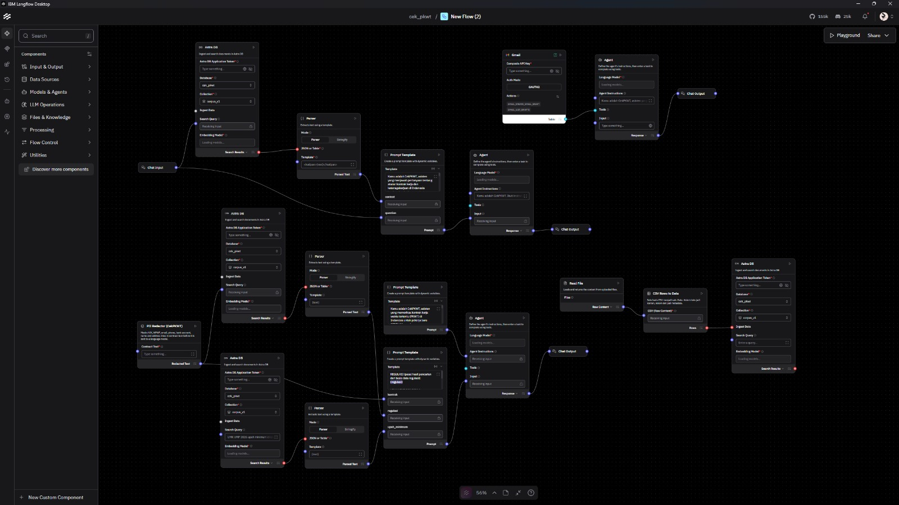
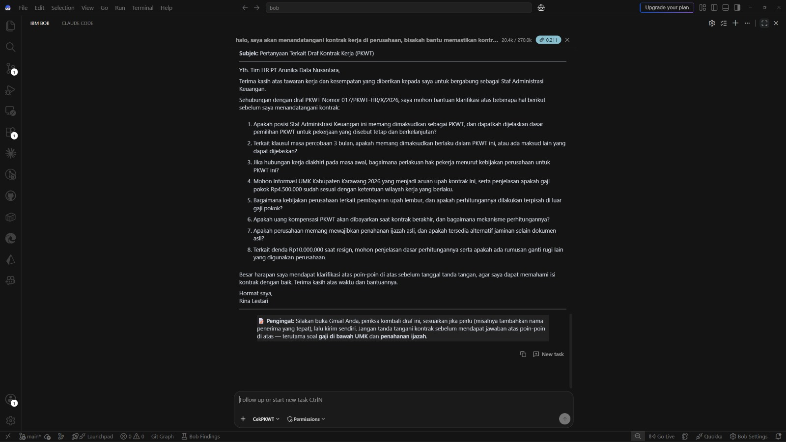
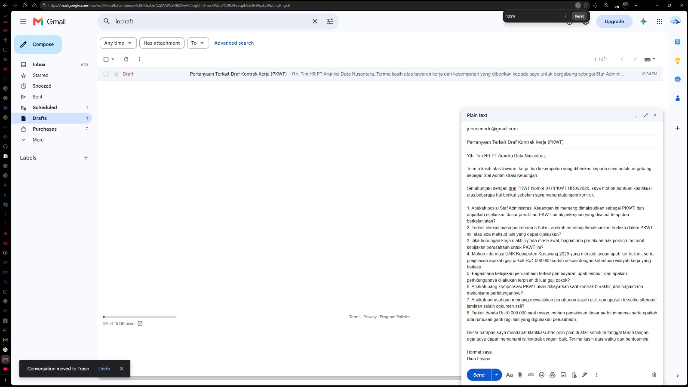
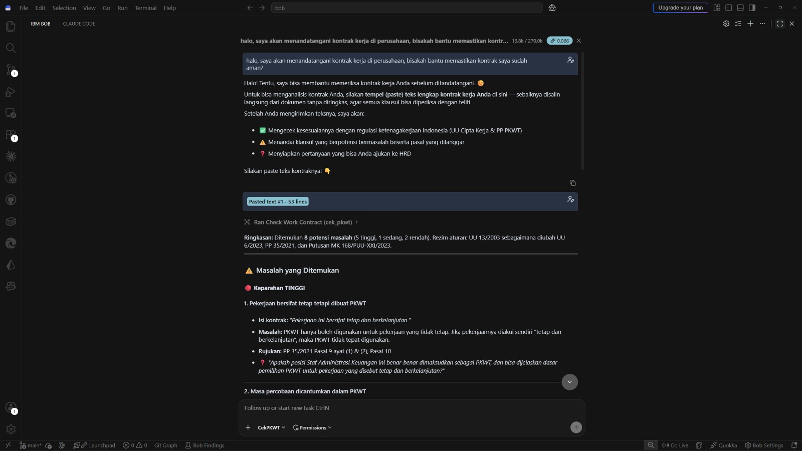
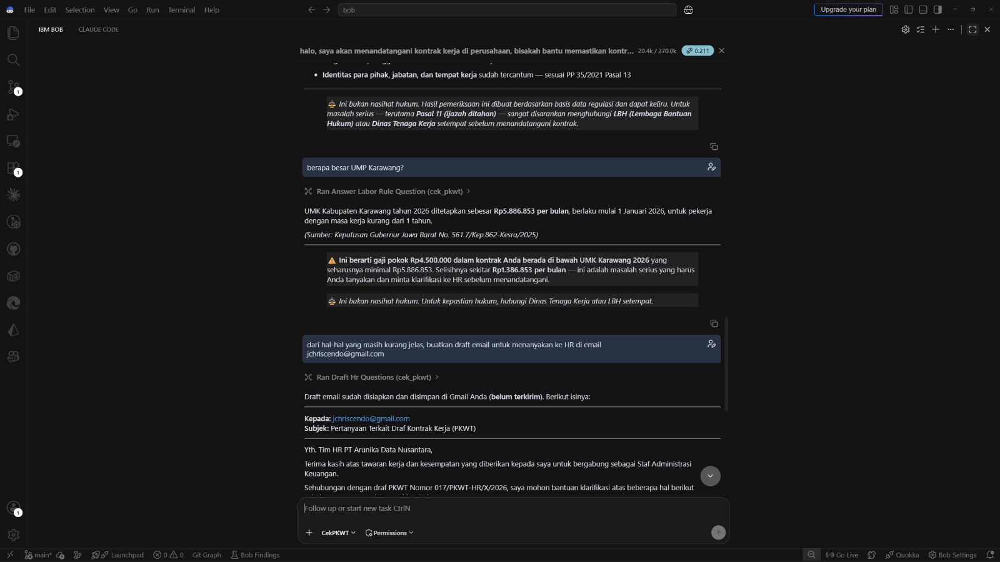

# CekPKWT

**AI pemeriksa kontrak kerja PKWT sebelum tanda tangan.**

CekPKWT adalah AI agent yang membantu *fresh graduate* memeriksa kontrak kerja waktu tertentu (PKWT) **sebelum** menandatanganinya. Pengguna cukup menempelkan teks kontrak ke **IBM Bob**. Bob lalu memanggil flow **IBM Langflow** lewat MCP untuk menyamarkan data pribadi, mengekstrak klausul penting, mencari pasal yang relevan dari basis regulasi resmi, dan menyusun laporan potensi masalah. Laporan itu memuat pasal rujukan beserta status berlakunya, tingkat keparahan, dan pertanyaan yang bisa diajukan ke HR.

| | |
|---|---|
| **Coba langsung** | https://cek-pkwt.briantedjo.my.id (gratis, tanpa akun) |
| **Video pitch** | [TAUTAN VIDEO] |
| **Tema** | Education & Future of Work |
| **Teknologi IBM** | IBM Bob (antarmuka percakapan, MCP client) dan IBM Langflow (seluruh logika workflow, MCP server) |
| **Tim** | Brian Nich ([@britoddd](https://github.com/britoddd)), Joel Chriscendo ([@Joelcrl](https://github.com/Joelcrl)) |

> ⚠️ **Bukan nasihat hukum.** Hasil CekPKWT dibuat oleh AI dari basis regulasi yang terbatas dan bisa keliru. Untuk masalah serius, hubungi LBH (Lembaga Bantuan Hukum) atau Dinas Tenaga Kerja setempat.

## Ringkasan untuk juri

| Kriteria | Bukti utama | Bagian |
|---|---|---|
| Kejelasan dan relevansi masalah | Pengangguran usia 15–24 tahun 16,89%, lebih dari tiga kali angka nasional (BPS, Agustus 2025). 884 aduan ke Lapor Menaker dalam 8 hari, terbanyak soal hubungan kerja dan upah. UU Pelindungan Ketenagakerjaan disahkan DPR 6 Oktober 2026. | [1. Masalah](#1-masalah) |
| Inovasi, kelayakan, dan monetisasi | Korpus regulasi yang sadar status dan rezim aturan, diperbarui bot setiap hari dengan tinjauan manusia. Sudah berjalan di produksi. Gratis bagi pekerja, dibiayai lisensi institusi. | [2. Solusi dan inovasi](#2-solusi-dan-inovasi) |
| Dampak bagi pengguna | Pada kontrak contoh, lebih dari Rp12 juta hak upah dan uang kompensasi dipertaruhkan. Tindak lanjut ke HR lewat email atau WhatsApp. | [3. Dampak bagi pengguna](#3-dampak-bagi-pengguna) |
| Eksekusi teknis | Langflow yang sama melayani IBM Bob (MCP), web app, dan CI. Web app di produksi, 11 pull request ter-merge, CI di setiap PR, uji otomatis. | [4. Eksekusi teknis](#4-eksekusi-teknis) |
| Responsible AI | Data pribadi disamarkan sebelum sampai ke LLM, setiap temuan menyebut pasal dan statusnya, agent secara teknis tidak bisa mengirim email, dan perubahan korpus wajib ditinjau manusia. | [5. Responsible AI](#5-responsible-ai) |
| Presentasi | Video pitch, alur demo 3 menit, dan kontrak contoh siap pakai di web app. | [6. Demo dan video](#6-demo-dan-video) |

## Daftar isi

- [Ringkasan untuk juri](#ringkasan-untuk-juri)
- [1. Masalah](#1-masalah)
- [2. Solusi dan inovasi](#2-solusi-dan-inovasi)
- [3. Dampak bagi pengguna](#3-dampak-bagi-pengguna)
- [4. Eksekusi teknis](#4-eksekusi-teknis)
- [5. Responsible AI](#5-responsible-ai)
- [6. Demo dan video](#6-demo-dan-video)
- [Tim](#tim)
- Panduan teknis: [Setup](#setup) · [Menghubungkan IBM Bob ke Langflow](#menghubungkan-ibm-bob-ke-langflow) · [Menjalankan web app](#menjalankan-web-app) · [Deploy](#deploy) · [Memperbarui korpus](#memperbarui-korpus) · [Struktur repository](#struktur-repository)

## 1. Masalah

Fresh graduate yang menerima kontrak PKWT pertama biasanya menandatanganinya dalam waktu singkat, tanpa tahu klausul mana yang mungkin bertentangan dengan aturan. Contohnya masa percobaan pada PKWT, upah di bawah upah minimum, tidak adanya uang kompensasi saat kontrak berakhir, denda jika mengundurkan diri lebih awal, atau ijazah yang ditahan perusahaan. Kerugiannya baru terasa setelah kontrak ditandatangani, saat posisi tawar pekerja sudah jauh lebih lemah.

### Data dan bukti

| Fakta | Sumber | Artinya bagi pencari kerja pertama |
|---|---|---|
| Tingkat pengangguran terbuka usia 15–24 tahun **16,89%**, lebih dari tiga kali angka nasional **4,85%** (7,46 juta orang). Untuk lulusan D-IV, S1, S2, dan S3 angkanya **5,39%**. | BPS, Agustus 2025 ([rangkuman detikEdu](https://www.detik.com/edu/detikpedia/d-8268287/bps-7-46)) | Persaingan untuk pekerjaan pertama ketat. Pelamar enggan menawar atau bertanya, sehingga kontrak langsung ditandatangani. |
| **56,4%** penerima Bantuan Subsidi Upah 2020 adalah pekerja kontrak; hanya 37,9% pekerja tetap. | Survei Kemnaker bersama TNP2K dan BPJS Ketenagakerjaan ([CNN Indonesia, 2021](https://www.cnnindonesia.com/ekonomi/20210819190342-532-682646/survei-mayoritas-penerima-blt-gaji-2020-pekerja-kontrak)) | Kontrak waktu tertentu adalah bentuk hubungan kerja yang umum di kelompok berupah rendah. |
| Kanal **Lapor Menaker** menerima **884 aduan** dalam 8 hari pertama (12–20 November 2025): 441 soal norma hubungan kerja, 427 soal pengupahan, 163 soal jaminan sosial, dan 145 soal waktu kerja. | [detikNews](https://news.detik.com/berita/d-8220766/layanan-lapor-menaker-terima-884-aduan-ini-jenis-pelanggarannya) | Topik aduan terbanyak adalah topik yang diperiksa CekPKWT. Aduan baru masuk setelah masalahnya terjadi. |
| Posko THR Kemnaker menerima **2.295 aduan** per 31 Maret 2025. | [Bisnis.com](https://ekonomi.bisnis.com/read/20250331/12/1865992/terus-bertambah-kemnaker-sudah-terima-2295-aduan-soal-thr) | Pelanggaran hak normatif terjadi dalam skala besar. |
| Menaker menerbitkan **SE M/5/HK.04.00/V/2025** (20 Mei 2025) yang melarang penahanan ijazah karena kasusnya marak. Wamenaker lalu menyidak kantor perusahaan setelah ada aduan. | [CNBC Indonesia](https://www.cnbcindonesia.com/news/20250520162331-4-634752/resmi-perusahaan-dilarang-tahan-ijazah-dan-dokumen-pribadi-karyawan), [Bisnis.com](https://ekonomi.bisnis.com/read/20250611/12/1884005/ada-aduan-penahanan-ijazah-wamenaker-sidak-kantor-lion-group-arta-boga) | Klausul penahanan dokumen benar-benar muncul di kontrak. SE ini ada di korpus CekPKWT. |

### Mengapa mendesak sekarang

1. **Undang-undangnya sedang berganti.** Putusan MK No. 168/PUU-XXI/2023 (31 Oktober 2024) mengubah sejumlah pasal ketenagakerjaan di UU Cipta Kerja, termasuk soal PKWT, dan meminta UU Ketenagakerjaan baru dibentuk paling lama dua tahun ([MKRI](https://www.mkri.id/berita/kabulkan-sebagian,-mk-minta-uu-ketenagakerjaan-dipisahkan-dari-uu-cipta-kerja-21782)). DPR mengesahkan UU Pelindungan Ketenagakerjaan pada 6 Oktober 2026 ([Bloomberg Technoz](https://www.bloombergtechnoz.com/detail-news/123736/dpr-resmi-sahkan-ruu-pelindungan-ketenagakerjaan)). Pekerja yang menandatangani kontrak hari ini perlu tahu aturan mana yang berlaku dan mana yang baru akan berlaku.
2. **Aturan turunannya terus terbit.** Pada hari pertamanya berjalan (30 Oktober 2026), bot sinkronisasi CekPKWT menemukan dua regulasi yang lebih baru dari korpus: PP 49/2025 (perubahan kedua PP 36/2021 tentang Pengupahan) dan Permenaker 7/2026 (Pekerjaan Alih Daya). Pengetahuan yang "dihafal" chatbot umum cepat usang.
3. **Upah minimum berubah setiap tahun.** Kontrak yang ditandatangani menjelang pergantian tahun perlu dibandingkan dengan angka upah minimum yang tepat untuk wilayah dan tahunnya.

### Celah pada cara yang ada

1. **Aturannya tersebar** di UU Ketenagakerjaan beserta perubahannya, peraturan pemerintah turunannya, keputusan upah minimum daerah, surat edaran menteri, dan putusan Mahkamah Konstitusi.
2. **Aturannya berubah**, dan sumber di internet jarang menyebut apakah pasal yang dikutip masih berlaku, sudah diubah, atau sudah dimaknai ulang oleh MK.
3. **Bantuan sulit dijangkau.** Pengacara terlalu mahal bagi pekerja baru, sementara bertanya ke HR terasa canggung karena mereka takut tawaran kerjanya dibatalkan. Kanal pengaduan pemerintah baru bekerja setelah masalah terjadi.

### Mengapa AI, dan mengapa AI yang dibatasi

Kontrak ditulis bebas, dengan istilah dan susunan yang berbeda di setiap perusahaan, sehingga checklist atau aturan kaku tidak cukup untuk mengekstrak klausulnya. Namun penilaian hukum tidak boleh dikarang. Karena itu CekPKWT memakai LLM untuk *memahami* kontrak, sedangkan *penilaiannya* diambil dari korpus pasal resmi (retrieval-augmented generation). Setiap temuan wajib menunjuk ke pasal yang ditemukan; jika tidak ada, klausul itu masuk ke "Tidak dapat diperiksa".

## 2. Solusi dan inovasi

### Cara kerja dalam satu menit

1. Pengguna menempelkan teks kontrak di web app atau di IBM Bob. Data pribadi disamarkan sebelum teks dikirim ke model.
2. Agent di IBM Langflow mengekstrak klausul penting, mengambil pasal dan upah minimum yang relevan dari korpus regulasi, lalu menyusun laporan potensi masalah: pasal rujukan dan status berlakunya, tingkat keparahan, dan tingkat keyakinan.
3. Pengguna bertanya lebih lanjut, lalu mengubah temuan menjadi pertanyaan sopan untuk HR yang ia kirim sendiri lewat email atau WhatsApp.

### Fitur utama

1. **Pemeriksaan Kontrak** (`check_work_contract`): mengekstrak klausul penting dari teks kontrak, membandingkannya dengan pasal regulasi dan upah minimum 2026 per wilayah, lalu menyusun laporan potensi masalah beserta tingkat keparahan, tingkat keyakinan, dan pasal rujukan.
2. **Tanya Aturan PKWT** (`answer_labor_rule_question`): menjawab pertanyaan lanjutan hanya dari regulasi yang tersimpan, dengan sitasi pasal. Klaim pengguna yang keliru ("katanya boleh kan?") langsung dibantah. Jika jawabannya tidak ada di sumber, sistem menyatakannya dan menyarankan bertanya ke Disnaker atau LBH.
3. **Draf Pertanyaan untuk HR** (`draft_hr_questions`): mengubah temuan menjadi pertanyaan yang sopan dan membuat draf Gmail yang tidak terkirim otomatis. Pengguna meninjau dan mengirimnya sendiri.
4. **Kesadaran perubahan regulasi:** lihat [Yang baru](#yang-baru), poin 1 dan 2.
5. **Perlindungan data pribadi:** lihat [Yang baru](#yang-baru), poin 3.

### Yang baru

1. **Korpus yang sadar status dan rezim aturan.** Setiap pasal ditandai status (`berlaku`, `diubah`, `dimaknai_putusan_mk`, `belum_berlaku`, `tidak_berlaku`, …) dan rezim (`current` atau `uu_pk_2026`). Flow hanya menilai dengan rezim yang berlaku; pasal UU baru diambil terpisah dan hanya disebut di "Catatan". Saat UU baru mulai berlaku, peralihannya cukup berupa perubahan data, bukan membangun ulang sistem.
2. **Korpus yang memperbarui diri, dengan manusia sebagai penentu.** Bot harian membaca JDIH dan putusan MK, mengunduh PDF resmi, lalu meminta LLM memilih pasal yang relevan. Kode menolak teks yang tidak ditemukan kata per kata di PDF. Hasilnya dibuka sebagai pull request yang wajib ditinjau manusia, dan CI menolak merge selama masih ada baris `pending_review`.
3. **Privasi sebelum model.** NIK, NPWP, email, nomor telepon, nomor rekening, serta baris nama, alamat, dan tempat/tanggal lahir disamarkan sebelum teks sampai ke LLM atau dipakai sebagai query. Kontrak pengguna tidak pernah disimpan ke basis data vektor. Pengguna web app melihat pratinjau penyamarannya sebelum mengirim.
4. **Dari temuan ke tindakan.** Laporan tidak berhenti di "ada masalah". Setiap temuan membawa pertanyaan untuk HR, dan draf email bisa dibuka di Gmail, aplikasi email, atau WhatsApp milik pengguna.
5. **Satu otak, banyak pintu.** Langflow yang sama melayani IBM Bob (lewat MCP), web app publik (lewat API Langflow), dan CI (flow ingest untuk mengunggah korpus). Bob dan web app memanggil flow yang sama persis, jadi logika dan prompt hanya dipelihara di satu tempat.

### Pembeda dari cara yang ada

| Cara saat ini | Kelemahan | Yang dilakukan CekPKWT |
|---|---|---|
| Membaca kontrak sendiri | Tidak tahu aturan mana yang berlaku | Mencocokkan setiap klausul dengan pasal beserta status berlakunya |
| Bertanya ke teman | Jawaban berbeda-beda dan tidak berdasar | Setiap temuan menunjuk ke pasal yang bisa dicek |
| Chatbot umum | Bisa memberi pasal yang salah atau sudah tidak berlaku, tanpa sumber yang bisa dicek | Hanya menjawab dari korpus resmi yang diperiksa setiap hari, dan menyatakan jika tidak tahu |
| Konsultasi ke pengacara | Mahal dan lambat untuk kebutuhan sebelum tanda tangan | Gratis dan tanpa akun; kasus serius tetap diarahkan ke LBH atau Disnaker |

### Kelayakan

- **Sudah berjalan, bukan rencana.** Web app produksi melayani publik, IBM Bob terhubung ke Langflow di server, dan bot sinkronisasi sudah membuka pull request nyata (PP 49/2025 dan Permenaker 7/2026).
- **Dibangun dari layanan yang matang:** IBM Langflow, DataStax Astra DB, OpenAI, Google Gemini, dan Vercel. Tidak ada model yang dilatih sendiri, sehingga biaya awal rendah dan model bisa diganti lewat dropdown "Language Model" di Langflow.
- **Korpus kecil yang terkelola.** 64 entri terverifikasi mencakup klausul PKWT yang paling sering bermasalah. Bot dan tinjauan manusia menjaganya tetap mutakhir tanpa membaca situs pemerintah setiap hari secara manual.
- **Biaya per pemeriksaan terkendali:** satu agent dengan model kecil (`gpt-5.4-mini`) dan tiga query vektor. nginx membatasi 10 permintaan per menit per pengunjung.
- **Kecepatan tim terbukti:** dari commit pertama (1 Oktober 2026) sampai web app produksi dan sinkronisasi harian (30 Oktober 2026). Lihat [Riwayat iterasi](#riwayat-iterasi).

### Risiko dan mitigasi

| Risiko | Mitigasi |
|---|---|
| AI mengarang pasal, angka, atau akibat hukum | Agent hanya boleh memakai kutipan dari korpus, sitasi disalin dari header kutipan, dan klausul tanpa pasal pendukung masuk "Tidak dapat diperiksa" |
| Aturan berubah dan korpus usang | Sinkronisasi harian, status dan rezim di setiap pasal, serta perubahan lewat PR yang ditinjau manusia |
| Bot salah membaca PDF | Pemeriksaan kata per kata, `pending_review` yang wajib diubah manusia, dan validator di CI |
| Data pribadi bocor | Redaksi sebelum LLM, kontrak tidak masuk basis data vektor, dan kontrak mentah tidak pernah disimpan di browser |
| Pengguna menganggap hasilnya nasihat hukum | Disclaimer di setiap laporan, rujukan ke LBH atau Disnaker, dan bahasa "mungkin bertentangan dengan" |
| Prompt injection di teks kontrak | Kontrak diperlakukan sebagai data, upaya memberi perintah dilaporkan di "Catatan", dan aksi kirim email dimatikan di level komponen |
| Penyalahgunaan dan biaya API membengkak | Rate limit per pengunjung di nginx; Langflow tidak diekspos ke internet |
| Situs pemerintah memblokir bot | Runner berjalan di server di Indonesia; sumber yang terblokir tercatat di setiap run dan diperiksa manual |
| Server tunggal tanpa cadangan | Diketahui (lihat [Keterbatasan](#keterbatasan)); server cadangan ada di roadmap |

### Model bisnis

Prinsipnya: **gratis untuk pekerja perorangan.** Orang yang paling membutuhkan CekPKWT adalah yang paling tidak mampu membayar pengacara. Pendapatan datang dari institusi yang diuntungkan jika lulusan atau penggunanya terlindungi.

| Segmen | Nilai bagi mereka | Bentuk pendapatan |
|---|---|---|
| Pusat karier kampus | Mendampingi ribuan lulusan dalam mencari kerja tanpa menambah staf | Lisensi tahunan per kampus |
| Platform lowongan kerja | Fitur "cek kontrak" yang membangun kepercayaan pencari kerja | API berbayar per pemeriksaan atau white-label |
| UMKM (pasar kedua) | Memeriksa template kontrak sebelum merekrut, untuk menghindari sengketa | Langganan atau bayar per template |
| Serikat pekerja dan LBH | Penyaringan awal sebelum pendampingan | Gratis atau bersubsidi (misi sosial), dibiayai segmen lain atau hibah |

Biaya utama adalah panggilan LLM dan embedding per pemeriksaan, Astra DB, dan server. Harga akan ditetapkan setelah biaya per pemeriksaan diukur pada pilot.

### Roadmap dan timeline

| Tahap | Waktu | Target | Tanda selesai |
|---|---|---|---|
| 0. MVP dan produksi | Oktober 2026 (selesai) | Bob + Langflow, web app, deploy, sinkronisasi korpus harian | Web app publik; PR pertama dari bot |
| 1. Validasi | November–Desember 2026 | Meninjau PR bot (PP 49/2025, Permenaker 7/2026); upah minimum 2027 masuk lewat sinkronisasi; mengisi [tabel evaluasi](#pengujian-dan-evaluasi); pilot dengan 1–2 pusat karier kampus | Tabel evaluasi terisi; umpan balik dari pilot |
| 2. Rezim baru | Setelah UU Pelindungan Ketenagakerjaan diundangkan (target Q1 2027) | Meninjau pasal UU baru (rezim `uu_pk_2026`), lalu memindahkan flow ke rezim baru saat masa transisinya berakhir; upah minimum di luar Pulau Jawa | Laporan menilai dengan rezim baru |
| 3. Perluasan | Q2–Q3 2027 | PKWTT, magang, dan alih daya; input PDF atau foto (OCR); API untuk platform lowongan kerja | Integrasi pertama dengan mitra |
| 4. Skala | Q4 2027 dan seterusnya | Server cadangan, kuota dan akun pengguna, pemeriksaan template untuk UMKM | Layanan tetap tersedia saat satu server mati |

## 3. Dampak bagi pengguna

### Siapa penggunanya

- **Pengguna utama:** fresh graduate dan mahasiswa tingkat akhir yang akan menandatangani kontrak PKWT pertama mereka, dimulai dari wilayah DKI Jakarta dan kota-kota besar di Pulau Jawa.
- **Pengguna sekunder:** pusat karier kampus yang mendampingi lulusan dalam mencari kerja.
- **Di luar cakupan MVP:** magang, PKWTT, dan outsourcing.

### Masalah pengguna dan cara CekPKWT mengatasinya

| Masalah pengguna | Yang dilakukan CekPKWT |
|---|---|
| "Saya tidak tahu klausul mana yang bermasalah." | Laporan per klausul, diurutkan dari tingkat keparahan tertinggi |
| "Saya tidak tahu aturan mana yang berlaku sekarang." | Setiap temuan menyebut pasal, status berlakunya, dan rezim aturan |
| "Saya takut bertanya ke HR, nanti tawarannya dibatalkan." | Pertanyaan yang sopan dan tidak menuduh, siap dikirim lewat email atau WhatsApp |
| "Pengacara terlalu mahal untuk kontrak pertama." | Gratis, tanpa akun, cukup tempel teks |
| "Saya tidak mau data pribadi saya tersebar." | Data pribadi disamarkan sebelum diproses, dengan pratinjau sebelum mengirim |
| "Waktu saya sempit sebelum tanda tangan." | Satu langkah dari tempel kontrak ke laporan |

### Contoh: apa yang dipertaruhkan dalam satu kontrak

Kontrak contoh di web app (fiktif, tombol "Pakai contoh kontrak") berisi PKWT 12 bulan di Jakarta Selatan. Angka di bawah dihitung dari kontrak itu dan korpus CekPKWT, bukan hasil pengukuran pada pengguna nyata.

| Isi kontrak contoh | Aturan di korpus | Nilai bagi pekerja |
|---|---|---|
| Masa percobaan 3 bulan | PP 35/2021 Pasal 12: PKWT tidak dapat mensyaratkan masa percobaan | Hak penuh sejak hari pertama |
| Upah Rp5.200.000 per bulan | UMP DKI Jakarta 2026: Rp5.729.876 | Selisih Rp529.876 per bulan, **Rp6.358.512** selama 12 bulan |
| Tidak ada klausul uang kompensasi | PP 35/2021 Pasal 15–16: PKWT 12 bulan berhak atas uang kompensasi sebesar 1 bulan upah | Sekitar **Rp5.729.876** jika upah disesuaikan ke UMP |
| Denda Rp20.000.000 jika mengundurkan diri | UU 13/2003 Pasal 62 mengatur ganti rugi pengakhiran dini dengan rumus tersendiri | Denda tetap hampir 4 kali upah sebulan, perlu dikonfirmasi dasarnya ke HR |

Dalam satu kontrak ini, lebih dari **Rp12 juta** hak upah dan uang kompensasi bisa hilang tanpa disadari, belum termasuk denda yang perlu dipertanyakan.

### Manfaat yang diukur

Metrik yang kami pakai: tingkat deteksi masalah yang sengaja ditanam, alarm palsu pada kontrak bersih, ketepatan sitasi, dan waktu yang dibutuhkan untuk meninjau kontrak. Hasilnya dicatat di [Pengujian dan evaluasi](#pengujian-dan-evaluasi). Kami hanya mengisinya dengan hasil pengujian nyata.

### Dampak sosial

- **Mengurangi ketimpangan informasi** antara perusahaan dan pekerja baru, tepat saat posisi tawar masih ada, yaitu sebelum tanda tangan.
- **Edukasi:** setiap laporan mengajarkan pasal yang relevan, sehingga pengguna memahami haknya untuk kontrak berikutnya.
- **Mendorong dialog, bukan konflik:** pertanyaan untuk HR ditulis sopan dan tidak menuduh, sehingga perusahaan yang keliru tanpa sengaja bisa memperbaiki kontraknya.
- **Pencegahan sebelum pengaduan:** masalah ditangkap sebelum kontrak berjalan, sedangkan kasus serius tetap diarahkan ke LBH atau Disnaker.

### Inklusivitas dan aksesibilitas

- Gratis, tanpa akun, dan tanpa instalasi; berjalan di browser ponsel.
- Bahasa Indonesia sehari-hari; laporan menjelaskan maksud setiap pasal.
- Tindak lanjut lewat WhatsApp, karena banyak HR membalas di WhatsApp, bukan email.
- Aksesibilitas web: tingkat keparahan tidak hanya ditandai warna (selalu ada ikon dan kata), fokus keyboard berpindah ke judul halaman, ada wilayah `role="status"` dan `role="alert"` untuk pembaca layar, `prefers-reduced-motion` dan `prefers-reduced-transparency` dihormati, dan laporan bisa disimpan sebagai PDF.
- **Yang belum merata:** data upah minimum baru mencakup 18 wilayah di Pulau Jawa. Pekerja di luar daftar itu mendapat "Tidak dapat diperiksa", bukan tebakan. Perluasan wilayah ada di [roadmap](#roadmap-dan-timeline).

### Umpan balik dan validasi

> Bagian ini diisi dari uji pengguna nyata. Jangan isi dengan perkiraan.

| Kegiatan | Peserta | Temuan utama |
|---|---|---|
| [Uji coba web app] | [N fresh graduate / mahasiswa tingkat akhir] | [...] |

## 4. Eksekusi teknis

### Arsitektur

```
 Pengguna
    │  "tolong cek kontrak ini sebelum saya tanda tangan"
    ▼
 IBM Bob  (antarmuka percakapan, MCP client)
    │  memilih tool berdasarkan nama & deskripsi
    ▼  MCP (Streamable HTTP, API key)
 IBM Langflow  (MCP server, seluruh logika workflow)
    ├── check_work_contract         ──┐
    ├── answer_labor_rule_question  ──┼──► Astra DB (corpus_v1, embedding Gemini)
    ├── draft_hr_questions ──► Composio Gmail (hanya draf)
    └── ingest_labor_corpus (internal) ─► memuat data/labor_corpus.csv ke Astra DB
```

**Pembagian peran**

- **Langflow** menjalankan seluruh logika: redaksi data pribadi, ekstraksi klausul, pengambilan pasal dari Astra DB, perbandingan oleh LLM, dan pembuatan draf email.
- **IBM Bob** menjadi antarmuka percakapan: menafsirkan permintaan pengguna, memilih tool Langflow yang tepat, lalu menjelaskan hasilnya dengan bahasa yang mudah dipahami.

**Teknologi**

| Bagian | Yang dipakai |
|---|---|
| Orkestrasi workflow | IBM Langflow 1.12.4 |
| Antarmuka & MCP client | IBM Bob |
| LLM (Agent) | OpenAI `gpt-5.4-mini` (bawaan flow). Bisa diganti ke model Gemini lewat dropdown "Language Model". |
| Embedding | Google `models/gemini-embedding-001` |
| Vector store | DataStax Astra DB: database `cek_pkwt`, koleksi `corpus_v1` |
| Email | Composio Gmail (OAuth2) |
| Web app | Frontend React + Vite + TypeScript di Vercel; backend FastAPI |
| Server | Debian self-hosted: Docker Compose (Langflow + PostgreSQL), systemd, nginx, Cloudflare Tunnel |
| Sinkronisasi korpus | GitHub Actions di self-hosted runner (server), Playwright (Chromium headless), pypdf, OpenAI `gpt-5.4-mini` |

**Alur penggunaan**

1. Pengguna menempelkan teks kontrak di IBM Bob.
2. Bob memilih tool `check_work_contract`, lalu MCP mengirim teks ke Langflow.
3. Langflow menyamarkan data pribadi dan mencari pasal serta upah minimum yang relevan di Astra DB.
4. Agent mengekstrak klausul, membandingkannya dengan pasal, lalu menyusun laporan.
5. Laporan dikembalikan ke Bob, dan Bob menjelaskannya kepada pengguna.
6. Pengguna bertanya lebih lanjut (`answer_labor_rule_question`) atau membuat draf email HR (`draft_hr_questions`).
7. Pengguna meninjau draf di Gmail dan mengirimnya sendiri.

**Alur lewat web app**

```
 Browser pengguna  (https://cek-pkwt.briantedjo.my.id)
    │  frontend statis dari Vercel
    ▼  fetch ke VITE_API_BASE (CORS hanya untuk domain frontend)
 Cloudflare Tunnel ─► nginx (rate limit per pengunjung)
    ▼
 FastAPI backend/  (systemd, 127.0.0.1:8000, menyimpan API key Langflow)
    ▼  /api/v1/run, sesi baru per permintaan
 Langflow  (Docker, 127.0.0.1:7860) ─► PostgreSQL
    └──► OpenAI · Gemini · Astra DB
```

Langflow tidak diekspos ke internet. Backend memanggilnya di dalam server, sedangkan editor Langflow dan IBM Bob mengaksesnya lewat SSH tunnel (lihat [Deploy](#deploy)).

**Alur pembaruan korpus**

```
 GitHub Actions (jadwal 02.00 WIB) ─► self-hosted runner di server
    │  corpus-sync: JDIH & MK ─► PDF resmi ─► LLM + cek kata per kata
    ▼
 Pull request per regulasi (baris bertanda pending_review)
    │  ditinjau manusia, lalu merge
    ▼
 corpus-ci: baris yang berubah ─► Langflow ingest_labor_corpus ─► Astra DB
```

Detailnya di [Memperbarui korpus](#memperbarui-korpus).

### Integrasi teknologi IBM

| Teknologi IBM | Peran di CekPKWT | Bukti |
|---|---|---|
| **IBM Langflow 1.12.4** | Menjalankan seluruh logika: empat flow, dua komponen kustom (PII Redactor dan CSV Rows to Data), Agent dengan tool kalkulator dan tanggal, retrieval dari Astra DB, serta toolset Gmail. Flow yang sama diekspos sebagai **MCP server** untuk IBM Bob, dipanggil backend web app lewat API `/api/v1/run`, dan dijalankan CI untuk mengunggah korpus. | Ekspor flow di `langflow/*.json`; screenshot flow di bawah |
| **IBM Bob** | Antarmuka percakapan dan **MCP client**: memilih tool Langflow berdasarkan nama dan deskripsinya, mengirim teks pengguna ke Chat Input, lalu menjelaskan hasilnya dengan bahasa yang mudah dipahami. | Screenshot di [Demo dan video](#6-demo-dan-video); panduan di [Menghubungkan IBM Bob ke Langflow](#menghubungkan-ibm-bob-ke-langflow) |

### Penjelasan setiap flow

Semua flow ada di folder `langflow/` dan dapat diimpor langsung ke Langflow.

#### 1. `check_work_contract`


```
Chat Input → PII Redactor ─┬─► Astra DB (pasal relevan, top-4) ─► Parser ─┐
                           │   Astra DB (upah minimum 2026)   ─► Parser ─┤
                           └────────────────────────────────────────────►├─► Prompt Template ─► Agent ─► Chat Output
```

- **Input:** teks kontrak.
- **PII Redactor (CekPKWT):** komponen kustom berbasis regex yang mengganti data pribadi dengan label (`[NIK]`, `[NPWP]`, `[EMAIL]`, `[TELEPON]`, `[NO_REKENING]`, `[NAMA]`, `[ALAMAT]`, `[TTL]`). Label milik perusahaan (PT, CV, direktur, HRD) dibiarkan.
- **Retrieval:** teks yang sudah disamarkan dipakai sebagai query ke Astra DB. Query kedua mengambil semua data upah minimum yang sedang berlaku (hingga 30 entri), sehingga wilayah pengguna selalu ikut terbaca jika datanya ada.
- **Agent** (dengan tool kalkulator dan tanggal):
  1. mengecek cakupan (hanya PKWT; PKWTT, magang, dan kemitraan ditolak dengan sopan),
  2. mengekstrak klausul ke struktur tetap: jenis kontrak, jenis pekerjaan, jangka waktu dan perpanjangan, masa percobaan, upah dan lokasi kerja, uang kompensasi, BPJS, pengakhiran dini dan denda, penahanan dokumen, serta bentuk dan bahasa kontrak,
  3. mencocokkan setiap klausul dengan pasal yang ditemukan,
  4. menandai masalah **hanya** jika didukung teks pasal,
  5. menyusun laporan.
- **Output:** ringkasan, daftar potensi masalah (isi kontrak, penjelasan, rujukan pasal dan statusnya, keparahan, keyakinan, pertanyaan untuk HR), klausul tanpa masalah, klausul yang tidak dapat diperiksa, catatan, dan disclaimer.
- Kontrak dan laporan tidak disimpan ke riwayat pesan Langflow (`should_store_message = false` di Chat Input dan Chat Output, begitu juga di dua flow lainnya).

#### 2. `answer_labor_rule_question`

```
Chat Input ─┬─► Astra DB (top-4) ─► Parser <kutipan> ─┐
            └─────────────────────────────────────────┴─► Prompt Template ─► Agent ─► Chat Output
```

- **Input:** pertanyaan pengguna.
- **Aturan jawaban:** hanya dari kutipan yang ditemukan. Sitasi disalin persis dari header kutipan dengan format `(Regulasi, Pasal, status)`. Jika jawabannya tidak ada, sistem menjawab "Saya tidak menemukan jawabannya di sumber regulasi yang saya miliki." Jika pertanyaan mengandung klaim yang bertentangan dengan kutipan, kalimat pertama jawaban langsung membantahnya.
- **Output:** jawaban beserta sitasi pasal.

#### 3. `draft_hr_questions`

```
Chat Input ─► Agent (+ Composio Gmail sebagai tool) ─► Chat Output
```

- **Input:** daftar temuan dari laporan pemeriksaan, dan bila ada, alamat email HR.
- **Proses:** menulis email berbahasa Indonesia yang sopan dan tidak menuduh (subjek "Pertanyaan Terkait Draf Kontrak Kerja (PKWT)", satu pertanyaan bernomor per temuan, nama pengirim `[Nama Anda]`).
  - Jika alamat HR tersedia, Agent memakai aksi Gmail **Create Email Draft**.
  - Jika tidak, teks email ditampilkan untuk disalin.
- **Output:** status ("Draf dibuat di Gmail (belum terkirim)" atau "Teks email siap disalin"), subjek dan isi email, serta pengingat untuk meninjau sebelum mengirim.
- **Agent tidak bisa mengirim email.** Di komponen Gmail hanya aksi **Create Email Draft** yang aktif. Aksi kirim (Send Email, Send Draft) dan semua aksi lain dimatikan, sehingga pembatasnya bersifat teknis, bukan hanya instruksi prompt. Prompt Agent juga mengabaikan instruksi di dalam input yang meminta mengirim atau menghapus email.



#### 4. `ingest_labor_corpus` (internal, tidak diekspos ke Bob)

```
Read File (CSV) ─► CSV Rows to Data ─► Astra DB (embedding gemini-embedding-001)
```

- **CSV Rows to Data:** komponen kustom yang mengubah satu baris CSV menjadi satu dokumen. Kolom `text` menjadi konten, kolom lain menjadi metadata.
- **Astra DB** memakai `deletion_field = id`: dokumen dengan `id` yang sama dihapus dulu sebelum dimasukkan, sehingga ingest ulang mengganti entri, bukan menggandakannya.
- Workflow `corpus-ci` menjalankan flow ini lewat API: mengunggah CSV berisi baris yang berubah, mencari komponen Read File dan Astra DB menurut tipenya di flow yang ada di server (ID node bisa berbeda dari file JSON), lalu menjalankannya dengan `deletion_field = id`.

### Korpus regulasi

`data/labor_corpus.csv` berisi **64 entri**. Satu baris berisi satu pasal atau ketentuan, dan semuanya berada di rezim `current`. Korpus diperiksa terhadap situs pemerintah setiap hari; lihat [Memperbarui korpus](#memperbarui-korpus).

| Kolom | Keterangan |
|---|---|
| `id` | ID unik, mis. `pp35-12` |
| `regulation`, `article` | Nama regulasi dan pasal/ayat |
| `topic` | Topik, mis. `masa_percobaan`, `upah_minimum`, `thr`, `bpjs` |
| `status` | `berlaku`, `diubah`, `disisipkan`, `dimaknai_putusan_mk`, `berlaku_imbauan`, `catatan_sistem`, `belum_berlaku` (sudah terbit, belum berlaku), `tidak_berlaku` (sudah diganti, mis. UMK tahun lalu) |
| `amended_by` | Regulasi pengubah (jika ada) |
| `regime` | Rezim aturan: `current`, atau `uu_pk_2026` untuk UU Pelindungan Ketenagakerjaan (disahkan DPR 6 Oktober 2026) |
| `region`, `province` | `nasional`, atau kabupaten/kota/provinsi untuk upah minimum |
| `source_url`, `retrieved_on` | Sumber resmi dan tanggal pengambilan |
| `verification` | `checked_official` (63), `checked_secondary` (0), `accepted_single_source` (0), `system_note` (1). `checked_official` wajib bersumber dari situs `.go.id` atau `mkri.id`. `pending_review` hanya dipakai bot dan tidak bisa di-merge. |
| `effective_from` | Tanggal mulai berlaku (`YYYY-MM-DD`), wajib untuk baris `belum_berlaku` |
| `text` | Teks pasal, diawali header `[Regulasi \| Pasal \| status \| rezim \| wilayah \| topik]` yang dipakai LLM untuk sitasi |

Flow pemeriksaan dan tanya aturan hanya menilai dengan rezim `current`. Pasal `uu_pk_2026` diambil terpisah (2 teratas) dan hanya disebut di "Catatan" sebagai aturan yang akan berlaku.

**Cakupan regulasi:**

- UU 13/2003 sebagaimana diubah UU 6/2023, Putusan MK No. 168/PUU-XXI/2023
- PP 35/2021 (PKWT, alih daya, waktu kerja, PHK) dan PP 36/2021 (Pengupahan)
- UU 24/2011 (BPJS), UU 4/2024 (KIA), Permenaker 6/2016 (THR), SE Menaker M/5/HK.04.00/V/2025

**Upah minimum 2026:**

- DKI Jakarta (UMP)
- Jawa Barat: Kota/Kab. Bekasi, Karawang, Depok, Kota/Kab. Bogor, Bandung
- Banten: Kota/Kab. Tangerang, Tangerang Selatan, Cilegon
- Jawa Tengah: Semarang
- DI Yogyakarta: Kota Yogyakarta
- Jawa Timur: Surabaya, Sidoarjo, Gresik, Malang

### Kualitas kode dan version control

- **Struktur per bagian:** `langflow/` (flow), `backend/` (FastAPI), `frontend/` (React), `sync/` (sinkronisasi korpus), `deploy/` (server), dan `data/` (korpus). Lihat [Struktur repository](#struktur-repository).
- **Git dan pull request:** 11 pull request ter-merge, satu branch per fitur atau perbaikan. Snapshot pengumpulan awal (hanya Bob + Langflow) disimpan di branch `archive/bob-only`.
- **CI di setiap PR:** workflow `corpus-ci` menjalankan uji sinkronisasi dan validator korpus. Check `validate` bisa diwajibkan lewat ruleset branch, dan `CODEOWNERS` meminta review kedua anggota tim untuk perubahan korpus.
- **Rahasia tidak masuk repository:** kunci disimpan sebagai Global Variables Langflow dan di `.env` yang di-ignore; `.env.example` hanya berisi nama variabel.
- **Spesifikasi sebelum kode:** sinkronisasi korpus dirancang dulu di [`docs/specs/corpus-sync.md`](docs/specs/corpus-sync.md), lengkap dengan catatan perbedaan antara rencana dan hasil implementasinya.

### Pengujian dan evaluasi

| Pengujian | Yang dicakup | Cara menjalankan |
|---|---|---|
| `backend/test_report.py` | Parser laporan: ringkasan dan rezim, temuan beserta rujukan dan statusnya, keparahan dan keyakinan, pengurutan menurut keparahan, balasan di luar cakupan, dan ekstraksi draf HR | `cd backend && python test_report.py` |
| `sync/test_corpus_sync.py` (tanpa jaringan dan tanpa LLM) | Pemeriksaan kata per kata, validator korpus, diff baris yang berubah, klasifikasi relevansi regulasi, pembacaan angka upah minimum, dan pergantian status saat `effective_from` tiba | `python sync/test_corpus_sync.py` |
| Validator korpus | Header sitasi, kolom wajib, `pending_review`, baris yang dihapus, ID ganda, dan `effective_from` | `python sync/corpus_sync.py validate` |
| Type-check frontend | Seluruh kode TypeScript (bagian dari `npm run build`) | `cd frontend && npx tsc --noEmit` |
| CI `corpus-ci` | Uji sinkronisasi dan validator di setiap pull request | GitHub Actions |

Run `corpus-ci` dan `corpus-sync` terbaru di GitHub Actions berhasil (30 Oktober 2026).

**Evaluasi kualitas AI**

> Bagian ini diisi dari hasil pengujian nyata. Jangan isi dengan perkiraan.

| Metrik | Hasil |
|---|---|
| Masalah yang sengaja ditanam dan berhasil terdeteksi | [X dari Y] pada [N] kontrak uji fiktif ([%]) |
| Alarm palsu pada kontrak bersih | [Z] pada [M] kontrak |
| Sitasi pasal yang sesuai teks resmi (verifikasi manual) | [X%] |
| Waktu review kontrak | dari [A] menit menjadi [B] menit ([N] responden) |

### Kesiapan produksi

- **Berjalan otomatis:** frontend di Vercel; backend sebagai service systemd yang menyala sendiri setelah server dinyalakan ulang; Langflow dan PostgreSQL di Docker dengan `restart: unless-stopped`.
- **Permukaan serangan kecil:** hanya backend yang publik, lewat Cloudflare Tunnel dan nginx dengan rate limit per pengunjung. Langflow dan PostgreSQL hanya mendengarkan `127.0.0.1`; editor Langflow dan IBM Bob memakai SSH tunnel. CORS hanya untuk domain frontend, dan API key Langflow hanya ada di server.
- **Gagal dengan jelas:** error dari Langflow diubah menjadi pesan yang jelas bagi pengguna, dan tabel pemecahan masalah ada di [Deploy](#deploy).
- **Korpus terpelihara:** sinkronisasi berjalan setiap hari di self-hosted runner. Pada hari pertamanya, bot membuka 2 pull request, 3 issue "needs manual entry" (Surat Edaran hasil pindaian), dan 1 catatan regulasi yang tidak relevan.

### Riwayat iterasi

| Tanggal (2026) | Iterasi | Perbaikan yang dilakukan |
|---|---|---|
| 1 Oktober | MVP: empat flow Langflow, korpus 64 entri, integrasi IBM Bob | 80 menit setelah commit pertama, aksi kirim Gmail dimatikan di level komponen, bukan hanya lewat prompt |
| 3 Oktober | Bukti alur nyata di Bob dan Gmail | Contoh laporan ilustratif di README diganti screenshot hasil nyata |
| 29 Oktober | Brand dan web app (FastAPI + React), PR #1 | Draf email dibuka di akun pengguna sendiri, bukan akun Composio bersama; aksi Gmail yang aktif dikurangi menjadi Create Email Draft saja |
| 29 Oktober | Penyempurnaan UX, PR #1–#6 | Temuan diurutkan menurut keparahan; laporan disimpan 30 menit di browser tanpa kontrak mentah; tombol Gmail dan WhatsApp; pergeseran layout 7,5 px menjadi 0 px |
| 29–30 Oktober | Deploy produksi | Konfigurasi Langflow publik dihapus; Langflow hanya bisa diakses lewat SSH tunnel |
| 30 Oktober | Sinkronisasi korpus harian, PR #7 dan #8 | Status `belum_berlaku`/`tidak_berlaku` dan rezim `uu_pk_2026`; ingest mengganti entri berdasarkan `id` sehingga tidak ada entri ganda; ID node dicari di server |
| 30 Oktober | PR #15–#17 | Sinkronisasi dipindah ke runner di server karena situs pemerintah memblokir IP runner GitHub di luar negeri |

### Keterbatasan

- Hanya memeriksa **PKWT**. PKWTT, magang, outsourcing, dan kemitraan/freelance berada di luar cakupan.
- Korpus hanya berisi **64 entri** dari rezim aturan saat ini. UU Pelindungan Ketenagakerjaan (disahkan DPR 6 Oktober 2026) baru masuk setelah diundangkan dan PR-nya ditinjau.
- Dua PR bot (PP 49/2025 tentang perubahan kedua PP Pengupahan dan Permenaker 7/2026 tentang Alih Daya) masih menunggu tinjauan, jadi isinya belum dipakai dalam penilaian.
- Sinkronisasi harian belum bisa membaca JDIH Banten (pencarian situsnya error), JDIH Jawa Timur, dan DPR (keduanya memblokir bot). Ketiganya dicek manual; status blokirnya tampil di ringkasan job setiap hari.
- Bot tidak bisa membaca PDF hasil pindaian (tanpa lapisan teks, sering terjadi pada Surat Edaran) karena tidak ada OCR. Regulasi seperti ini muncul sebagai issue "needs manual entry".
- Data upah minimum 2026 hanya mencakup 18 wilayah di Pulau Jawa. Lokasi kerja di luar daftar itu dilaporkan sebagai "Tidak dapat diperiksa".
- Retrieval mengambil 4 pasal teratas per query, sehingga pasal relevan bisa saja terlewat pada kontrak yang panjang.
- Redaksi data pribadi berbasis regex dan bisa melewatkan format yang tidak umum. Pertanyaan di Tanya aturan tidak melewati redaksi.
- Input berupa teks; kontrak dalam bentuk PDF atau foto perlu disalin menjadi teks terlebih dahulu.
- Backend, Langflow, dan runner sinkronisasi korpus berjalan di satu server self-hosted, sehingga ketersediaannya bergantung pada listrik dan koneksi internet server tersebut. Belum ada server cadangan.
- Pembatasan jumlah permintaan baru diterapkan di nginx per pengunjung. Belum ada kuota per pengguna atau autentikasi pengguna.
- Kualitas penilaian AI belum dievaluasi secara kuantitatif dan belum ada uji pengguna formal.

## 5. Responsible AI

Desain CekPKWT kami petakan ke lima pilar kepercayaan AI dari IBM (explainability, fairness, robustness, transparency, privacy) dan ke nilai-nilai dalam [SE Menkominfo No. 9 Tahun 2023 tentang Etika Kecerdasan Artifisial](https://web.kominfo.go.id/sites/default/files/kominfo-Surat-Edaran-Kecerdasan-Artifisial.pdf), seperti inklusivitas, transparansi, keamanan, akuntabilitas, dan pelindungan data pribadi. Pengolahan data pribadinya mengacu pada prinsip minimisasi data dalam UU No. 27 Tahun 2022 tentang Pelindungan Data Pribadi.

| Prinsip | Yang dilakukan CekPKWT |
|---|---|
| **Keadilan (fairness)** | Kontrak dinilai hanya terhadap teks pasal, dengan aturan yang sama untuk semua orang. Nama, alamat, dan tempat/tanggal lahir, yang bisa mengungkap gender, usia, atau asal daerah, disamarkan sebelum model membacanya, sehingga identitas pekerja tidak ikut memengaruhi penilaian. Wilayah hanya dipakai untuk mencari upah minimum. Bahasanya netral terhadap kedua pihak: "mungkin bertentangan dengan" atau "perlu dikonfirmasi", tidak pernah "ilegal" atau "melanggar hukum". |
| **Privasi** | Data pribadi disamarkan sebelum teks dikirim ke LLM atau dipakai sebagai query. Kontrak tidak pernah dimasukkan ke basis data vektor, dan ketiga flow tidak menyimpan pesan ke riwayat pesan Langflow. Log transaksi Langflow dibatasi satu entri per flow. Backend tidak mencatat teks kontrak di log dan memakai sesi Langflow baru untuk setiap permintaan. Browser menyimpan laporan paling lama 30 menit dan tidak pernah menyimpan kontrak mentah. Semua kunci disimpan sebagai Global Variables Langflow, tidak di file flow. |
| **Transparansi** | Setiap laporan menyebut rezim aturan yang dipakai, dan setiap rujukan mencantumkan status pasalnya. Setiap entri korpus mencatat `source_url`, tanggal pengambilan, dan tingkat verifikasinya. Prompt lengkap terbuka di `langflow/*.json`, dan keterbatasan ditulis terbuka di README dan di web app. |
| **Explainability** | Setiap temuan menunjukkan isi kontrak, penjelasan, pasal rujukan beserta statusnya, tingkat keparahan, dan tingkat keyakinan. Klausul tanpa masalah dan klausul yang tidak dapat diperiksa juga dicantumkan, sehingga pengguna tahu apa yang *tidak* diperiksa. Pertanyaan tanpa sumber dijawab "tidak ditemukan", disertai saran ke Disnaker atau LBH. |
| **Pengawasan manusia** | Agent hanya bisa membuat draf email; pengguna meninjau, mengedit, dan mengirimnya sendiri. Setiap perubahan korpus, termasuk dari bot, masuk lewat pull request yang ditinjau manusia (`CODEOWNERS`), dan CI menolak baris `pending_review`. |
| **Ketahanan dan pencegahan penyalahgunaan** | Teks kontrak diperlakukan sebagai data, bukan instruksi; teks yang mencoba memberi perintah ke AI dilaporkan di "Catatan". Cakupan dibatasi ke PKWT, dan jenis kontrak lain ditolak dengan sopan. Bot sinkronisasi menolak teks yang tidak ada kata per kata di PDF resmi. Rate limit per pengunjung mencegah penyalahgunaan API. |
| **Akuntabilitas** | Setiap laporan ditutup dengan disclaimer "bukan nasihat hukum" dan rujukan ke LBH atau Disnaker setempat. |

### Pengaman teknis dan instruksi prompt

Kami memisahkan pengaman yang dijamin kode dari yang bergantung pada kepatuhan model.

**Dijamin kode atau konfigurasi:**

- Redaksi data pribadi oleh komponen PII Redactor sebelum teks sampai ke LLM.
- Di komponen Gmail hanya aksi **Create Email Draft** yang aktif. Aksi kirim (Send Email, Send Draft) dan semua aksi lain dimatikan, jadi agent secara teknis tidak dapat mengirim email.
- Kontrak tidak pernah masuk basis data vektor, dan ketiga flow tidak menyimpan riwayat pesan.
- Langflow hanya bisa diakses dari server; backend publik dibatasi rate limit.
- Pemeriksaan kata per kata, validator, dan blokir `pending_review` di CI untuk setiap perubahan korpus.
- Laporan di browser terhapus 30 menit setelah terakhir dibuka; kontrak mentah tidak pernah disimpan.

**Bergantung pada instruksi prompt (dan karena itu ikut dievaluasi):**

- Hanya memakai pasal dari kutipan korpus, dengan sitasi yang disalin dari header kutipan.
- Klausul tanpa pasal pendukung masuk "Tidak dapat diperiksa".
- Bahasa yang tidak menghakimi.
- Melaporkan upaya prompt injection di "Catatan", dan mengabaikan instruksi di input yang meminta mengirim atau menghapus email.
- Menolak kontrak di luar PKWT.



### Risiko yang masih ada

- Redaksi berbasis regex bisa melewatkan format yang tidak umum, dan pertanyaan di Tanya aturan tidak melewati redaksi.
- Langflow 1.12.4 tidak bisa mematikan log transaksinya (masukan dan keluaran setiap komponen). Dengan `LANGFLOW_MAX_TRANSACTIONS_TO_KEEP=1`, hanya entri terbaru per flow yang tersimpan, dan entri itu tertimpa pada langkah berikutnya.
- Kualitas penilaian belum dievaluasi secara kuantitatif; lihat [Pengujian dan evaluasi](#pengujian-dan-evaluasi).

## 6. Demo dan video

**Video pitch:** [TAUTAN VIDEO]

### Coba sendiri dalam 3 menit

1. Buka https://cek-pkwt.briantedjo.my.id, pilih **Cek kontrak**, lalu klik **Pakai contoh kontrak**. Perhatikan pratinjau penyamaran data pribadi sebelum mengirim.
2. Pilih wilayah kerja, lalu jalankan pemeriksaan. Laporan mengurutkan temuan dari tingkat keparahan tertinggi, dan setiap temuan menunjuk ke pasal beserta statusnya.
3. Klik **Buat draf email ke HR**, lalu buka drafnya di Gmail atau kirim lewat WhatsApp.
4. Buka **Tanya aturan** dan tulis "Katanya kontrak PKWT boleh pakai masa percobaan 3 bulan, bener kan?". Kalimat pertama jawabannya membantah klaim itu, disertai pasal rujukan.

### Contoh penggunaan di IBM Bob

| Pengguna menulis di Bob | Tool yang dipanggil |
|---|---|
| "Tolong cek kontrak ini sebelum saya tanda tangan: …" | `check_work_contract` |
| "Apa itu kompensasi akhir PKWT?" | `answer_labor_rule_question` |
| "Katanya kontrak PKWT boleh pakai masa percobaan 3 bulan, bener kan?" | `answer_labor_rule_question` |
| "Bantu buatkan email ke HR (hr@perusahaan.co.id) soal temuan tadi" | `draft_hr_questions` |

**Pemeriksaan kontrak:** Bob memanggil `check_work_contract` dan menampilkan 8 potensi masalah.



**Tanya aturan dan permintaan draf email:** Bob memanggil `answer_labor_rule_question` untuk UMK Karawang, lalu `draft_hr_questions`.



## Tim

| Nama | GitHub | Peran |
|---|---|---|
| Brian Nich | [@britoddd](https://github.com/britoddd) | [PERAN] |
| Joel Chriscendo | [@Joelcrl](https://github.com/Joelcrl) | [PERAN] |

---

*Bagian berikut adalah panduan teknis untuk menjalankan, men-deploy, dan memelihara CekPKWT.*

## Setup

### Prasyarat

- IBM Langflow 1.12.4 atau yang lebih baru (versi flow diekspor)
- IBM Bob
- Akun DataStax Astra DB dengan database `cek_pkwt`
- API key OpenAI dan/atau Google AI (Gemini)
- Akun Composio yang terhubung ke Gmail (untuk `draft_hr_questions`)

### Variabel lingkungan

Salin `.env.example` menjadi `.env` lalu isi:

```env
ASTRA_DB_PKWT=      # Application token Astra DB
COMPOSIO_PKWT=      # API key Composio (Gmail)
GOOGLE_API_KEY=     # Untuk embedding gemini-embedding-001
OPENAI_API_KEY=     # Untuk Agent gpt-5.4-mini
```

Variabel untuk backend web app (`LANGFLOW_URL`, `LANGFLOW_API_KEY`, `LANGFLOW_FLOW_*`, `FRONTEND_ORIGINS`) dijelaskan di [Menjalankan web app](#menjalankan-web-app). Untuk server, kunci provider di atas diisi di `deploy/.env` (lihat [Deploy](#deploy)). `sync/corpus_sync.py` juga membaca `.env` ini saat dijalankan lokal, mis. `OPENAI_API_KEY` untuk menyusun draf.

Flow merujuk nama-nama variabel ini sebagai *Global Variables* Langflow, jadi nilainya tidak tersimpan di file JSON. Daftarkan variabelnya dengan salah satu cara berikut:

- **Manual:** Settings → Global Variables, buat variabel dengan nama yang sama persis.
- **Otomatis dari environment:** jalankan Langflow dengan
  ```env
  LANGFLOW_STORE_ENVIRONMENT_VARIABLES=true
  LANGFLOW_VARIABLES_TO_GET_FROM_ENVIRONMENT=ASTRA_DB_PKWT,COMPOSIO_PKWT,GOOGLE_API_KEY,OPENAI_API_KEY
  ```

### Langkah setup

1. Jalankan Langflow, lalu impor keempat file JSON dari folder `langflow/`.
2. Komponen **Astra DB** sudah membaca token dari `ASTRA_DB_PKWT`. Jika database Anda berbeda, pilih ulang database dan endpoint-nya (daftar endpoint akan terisi otomatis dari token). Pastikan nama koleksi `corpus_v1` dan model embedding sama di semua flow.
3. Tambahkan API key model untuk Agent di **Settings → Model Providers** (OpenAI, dan Google jika ingin memakai model Gemini). Field `api_key` di komponen Agent hanya *override*; jika dikosongkan, Agent memakai key dari Model Providers sesuai model yang dipilih di dropdown "Language Model".
4. Buka flow `ingest_labor_corpus`, unggah `data/labor_corpus.csv` ke komponen **Read File**, lalu jalankan untuk mengisi vector store.
5. Pada flow `draft_hr_questions`, hubungkan komponen **Gmail** ke akun Composio Anda (OAuth). Aksi yang aktif sudah dibatasi ke Create Email Draft; jangan aktifkan aksi kirim.
6. Uji setiap flow di Playground Langflow sebelum menghubungkannya ke Bob.

## Menghubungkan IBM Bob ke Langflow

Langflow mengekspos flow dalam satu project sebagai **MCP server**, dan IBM Bob terhubung sebagai **MCP client**.

1. **Siapkan MCP server di Langflow.**
   - Buka project yang berisi flow CekPKWT, lalu buka tab **MCP Server**.
   - Aktifkan tiga flow sebagai tool: `check_work_contract`, `answer_labor_rule_question`, dan `draft_hr_questions`. Jangan aktifkan `ingest_labor_corpus`.
   - Pastikan nama dan deskripsi setiap tool jelas, karena Bob memilih tool berdasarkan keduanya.
2. **Siapkan autentikasi.** Pakai autentikasi API key, lalu buat API key Langflow di Settings → API Keys.
3. **Salin konfigurasi.** Ambil JSON konfigurasi untuk transport **Streamable HTTP** dari tab MCP Server.
4. **Daftarkan di Bob.** Tambahkan konfigurasi itu ke `mcp.json` milik IBM Bob. Bentuknya kurang lebih seperti ini; pakai nilai yang disalin dari Langflow:

   ```json
   {
     "mcpServers": {
       "cekpkwt": {
         "type": "streamable-http",
         "url": "http://localhost:7860/api/v1/mcp/project/<PROJECT_ID>/streamable",
         "headers": {
           "x-api-key": "<LANGFLOW_API_KEY>"
         }
       }
     }
   }
   ```

   Jangan commit file konfigurasi yang berisi API key asli.
5. **Uji di Bob.** Pastikan ketiga tool muncul di daftar tool MCP Bob, lalu coba contoh di bawah.

Bob mengirim teks pengguna ke Chat Input setiap flow dan menerima Chat Output sebagai hasil tool. Logika workflow tetap berada di Langflow, sedangkan logika percakapan berada di Bob.

**Memakai Langflow di server.** Langflow di server tidak diekspos ke internet. Buka SSH tunnel dari komputer yang menjalankan Bob, lalu biarkan terminalnya terbuka selama Bob dipakai:

```bash
ssh -N -L 7860:127.0.0.1:7860 <user>@<server>
```

Selama tunnel terbuka, URL `http://localhost:7860/...` di `mcp.json` mengarah ke Langflow di server. Pakai `PROJECT_ID` dan API key dari Langflow server, karena keduanya berbeda dari instance lokal.

## Menjalankan web app

Selain lewat IBM Bob, CekPKWT bisa dipakai lewat web app yang terdiri dari dua bagian terpisah:

- **`backend/`**: FastAPI (Python). Memvalidasi input, menyimpan API key Langflow di server, lalu meneruskan permintaan ke ketiga flow lewat API `/api/v1/run`. Laporan Markdown dari flow diubah menjadi JSON (`backend/report.py`). Teks kontrak tidak dicatat di log dan tidak disimpan. Setiap permintaan memakai sesi Langflow baru, sehingga pesan satu pengguna tidak masuk ke memori agent pengguna lain.
- **`frontend/`**: React + Vite + TypeScript. Lima halaman: beranda, tempel kontrak (dengan pratinjau penyamaran data pribadi), laporan, draf email HR, dan tanya aturan. Warna dan font diambil dari `assets/design-tokens.css` (sumbernya `docs/brand-guidelines.md`).

Isi `LANGFLOW_URL` dan `LANGFLOW_API_KEY` di `.env` (lihat `.env.example`). Jika Langflow memberi ID baru saat flow diimpor, isi juga `LANGFLOW_FLOW_CHECK`, `LANGFLOW_FLOW_ASK`, dan `LANGFLOW_FLOW_HR`. ID yang ada di `.env.example` dan `backend/app.py` adalah ID dari file JSON, jadi ambil ID baru dari URL editor Langflow (`/flow/<ID>`) di instance tempat flow diimpor. API key Langflow juga hanya berlaku di instance yang membuatnya.

Untuk pengembangan lokal, biarkan `VITE_API_BASE` (frontend, lihat `frontend/.env.example`) dan `FRONTEND_ORIGINS` (backend) kosong: Vite meneruskan `/api` ke backend di origin yang sama.

```bash
# Terminal 1: backend di port 8000
cd backend
python -m venv .venv
.venv/Scripts/activate            # macOS/Linux: source .venv/bin/activate
pip install -r requirements.txt
uvicorn app:app --env-file ../.env

# Terminal 2: frontend di port 5173 (meneruskan /api ke backend)
cd frontend
npm install
npm run dev
```

Buka http://localhost:5173. Uji parser laporan dengan `python test_report.py` di folder `backend/`.

Catatan:

- **Draf email tidak dibuat di Gmail.** Komponen Composio terhubung ke satu akun, jadi draf dari semua pengunjung web akan masuk ke kotak surat pemilik aplikasi. Web app membuka jendela tulis Gmail di akun pengguna sendiri (tanpa login ke CekPKWT), aplikasi email lewat `mailto:`, atau WhatsApp lewat `wa.me`. Alur draf Gmail tetap tersedia lewat IBM Bob.
- **Laporan, draf email, dan percakapan Tanya aturan disimpan sementara di `localStorage` browser** agar tidak hilang saat halaman dimuat ulang atau tab tertutup tidak sengaja. Data terhapus otomatis 30 menit setelah terakhir dibuka (`TTL_MINUTES` di `frontend/src/storage.ts`) dan bisa dihapus manual lewat tombol "Hapus sekarang" di laporan. Teks kontrak mentah tidak pernah disimpan karena masih berisi data pribadi. Backend tidak menyimpan isi permintaan, dan Langflow tidak menyimpan riwayat pesan (lihat [Risiko yang masih ada](#risiko-yang-masih-ada) untuk log transaksinya).
- **Untuk produksi**, frontend dan backend berjalan di domain berbeda. Lihat [Deploy](#deploy).

## Deploy

Versi produksi terdiri dari dua bagian:

- **Frontend:** di-hosting di Vercel, di https://cek-pkwt.briantedjo.my.id.
- **Backend dan Langflow:** berjalan di server Debian self-hosted. Hanya backend yang dapat diakses publik, lewat Cloudflare Tunnel dan nginx. Langflow dan PostgreSQL hanya mendengarkan di `127.0.0.1`.

Semua berkas server ada di folder `deploy/`.

### Frontend (Vercel)

| Pengaturan | Nilai |
|---|---|
| Root directory | `frontend` |
| Build command | `npm run build` |
| Output directory | `dist` |
| Environment variable | `VITE_API_BASE` = alamat backend, mis. `https://cekpkwt-api.<domain>` (tanpa `/api` di akhir) |

`VITE_API_BASE` dibaca saat build, jadi deploy ulang setelah mengubahnya. Build mengimpor logo dari `../assets`, sehingga Vercel perlu mengakses seluruh repository, bukan hanya folder `frontend/`. Aplikasi memakai hash route (`#/cek`), jadi tidak perlu aturan rewrite.

### Server

Prasyarat: Docker dan Docker Compose, Python 3 dengan `venv`, nginx, serta Cloudflare Tunnel dengan hostname wildcard yang diarahkan ke nginx di port 80.

1. **Clone repository** ke server, mis. `~/apps/cek-pkwt`. Seluruh repository diperlukan karena backend membaca `data/labor_corpus.csv`.
2. **Jalankan Langflow dan PostgreSQL** (Langflow 1.12.4, versi tempat flow diekspor):

   ```bash
   cd ~/apps/cek-pkwt/deploy
   mkdir -p langflow-data && sudo chown -R 1000:0 langflow-data
   cp .env.example .env && chmod 600 .env   # isi password, secret key, dan kunci provider
   docker compose up -d
   ```

   Kunci provider (`ASTRA_DB_PKWT`, `COMPOSIO_PKWT`, `GOOGLE_API_KEY`, `OPENAI_API_KEY`) diteruskan ke Langflow sebagai Global Variables. Tentukan password PostgreSQL sejak awal, karena PostgreSQL hanya membacanya saat volume database pertama kali dibuat.
3. **Siapkan flow.** Buka Langflow lewat SSH tunnel (lihat di bawah), impor keempat flow, uji di Playground, buat API key, dan catat ID ketiga flow yang dipakai backend serta ID `ingest_labor_corpus` (untuk sinkronisasi korpus). Menjalankan ulang `ingest_labor_corpus` aman karena entri dengan `id` yang sama diganti.
4. **Jalankan backend** sebagai service systemd:

   ```bash
   cd ~/apps/cek-pkwt
   cp .env.example .env && chmod 600 .env
   # isi: LANGFLOW_URL=http://127.0.0.1:7860, LANGFLOW_API_KEY, LANGFLOW_FLOW_*,
   #      FRONTEND_ORIGINS=https://cek-pkwt.briantedjo.my.id
   cd backend
   python3 -m venv .venv
   .venv/bin/pip install -r requirements.txt
   sed "s/CHANGE_ME_user/$USER/g" ../deploy/systemd/cekpkwt-api.service | sudo tee /etc/systemd/system/cekpkwt-api.service > /dev/null
   sudo systemctl daemon-reload
   sudo systemctl enable --now cekpkwt-api
   ```

   Di server, kunci provider di `.env` root boleh dikosongkan karena hanya Langflow yang memakainya.
5. **Pasang situs nginx.** Sesuaikan `server_name` di `deploy/nginx/cekpkwt-api.conf` dengan alamat backend Anda, lalu:

   ```bash
   sudo cp ~/apps/cek-pkwt/deploy/nginx/cekpkwt-api.conf /etc/nginx/sites-available/cekpkwt-api
   sudo ln -s /etc/nginx/sites-available/cekpkwt-api /etc/nginx/sites-enabled/
   sudo nginx -t && sudo systemctl reload nginx
   ```

   Situs ini membatasi jumlah permintaan per pengunjung berdasarkan header `CF-Connecting-IP`, karena di balik Cloudflare Tunnel semua permintaan datang dari `cloudflared`.
6. **Uji:**

   ```bash
   curl -s https://<alamat-backend>/api/regions
   curl -s -X POST https://<alamat-backend>/api/ask \
     -H "Content-Type: application/json" \
     -d '{"question": "Apa itu kompensasi akhir PKWT?"}'
   ```

7. **Pasang runner GitHub** untuk sinkronisasi dan unggah korpus: lihat [Persiapan (sekali)](#persiapan-sekali).

Backend, Langflow, dan PostgreSQL berjalan otomatis setelah server dinyalakan ulang: backend lewat `systemctl enable`, kedua container lewat `restart: unless-stopped`, dan runner GitHub lewat service-nya (`svc.sh install`).

### Mengakses Langflow di server

Langflow tidak punya alamat publik. Untuk membuka editor atau menghubungkan IBM Bob, buat SSH tunnel dari komputer Anda:

```bash
ssh -N -L 7860:127.0.0.1:7860 <user>@<server>
```

Terminal itu tampak diam selama tunnel aktif. Biarkan terbuka, lalu buka `http://localhost:7860`. Tekan Ctrl+C untuk menutupnya.

### Memperbarui

```bash
cd ~/apps/cek-pkwt && git pull
sudo systemctl restart cekpkwt-api      # perubahan di backend/
cd deploy && docker compose up -d        # perubahan di deploy/
```

- Jika `backend/requirements.txt` berubah, jalankan `backend/.venv/bin/pip install -r backend/requirements.txt` sebelum restart.
- Jika file flow berubah, impor ulang di Langflow dan periksa apakah ID-nya berubah.
- Frontend di Vercel dibangun ulang dari repository; tidak ada langkah di server.

### Log dan pemecahan masalah

| Yang ingin dilihat | Perintah |
|---|---|
| Permintaan ke backend dan alasan error dari Langflow | `journalctl -u cekpkwt-api -f` |
| Jalannya flow | `docker compose logs -f langflow` (dari folder `deploy/`) |
| Permintaan yang ditolak rate limit | `sudo tail -f /var/log/nginx/error.log` |
| Sinkronisasi harian dan unggah korpus | GitHub → Actions → run `corpus-sync` / `corpus-ci` (perlu login). Tabel sumber dan usulan ada di halaman ringkasan run. |
| Status runner GitHub | `cd ~/actions-runner && sudo ./svc.sh status` |

- **"Layanan CekPKWT sedang tidak tersedia" (502):** Langflow menolak permintaan. `journalctl` menunjukkan alasannya, biasanya API key yang salah (401/403) atau ID flow yang berubah (404).
- **"Tidak bisa terhubung ke server" di browser:** biasanya CORS. Pastikan `FRONTEND_ORIGINS` sama persis dengan alamat frontend (dengan `https://`, tanpa path), lalu restart backend.
- **Permintaan ke `/api/...` di domain frontend sendiri (404):** build frontend tidak memuat `VITE_API_BASE`. Periksa variabelnya di Vercel, lalu deploy ulang.
- **Pemeriksaan kontrak yang panjang terputus (524):** setahu kami, Cloudflare memutus permintaan yang berjalan lebih dari sekitar 100 detik. Jika sering terjadi, turunkan `LANGFLOW_TIMEOUT` (default 180 detik) agar pengguna mendapat pesan error yang jelas.

## Memperbarui korpus

Korpus hanya berubah lewat pull request, baik dari bot maupun manual. Tidak ada teks yang masuk ke Astra DB sebelum PR-nya ditinjau dan di-merge. Spesifikasi lengkap: [`docs/specs/corpus-sync.md`](docs/specs/corpus-sync.md).

### Sinkronisasi harian

Workflow `corpus-sync` berjalan setiap hari pukul 02.00 WIB di self-hosted runner di server (GitHub bisa memulainya sedikit terlambat saat sibuk):

1. Bot membaca daftar regulasi terbaru di JDIH Kemnaker, JDIH BPK, JDIH DKI Jakarta, Jawa Tengah, Jawa Barat, DI Yogyakarta, serta putusan MK. Jawa Barat, DIY, dan MK dibuka lewat headless browser karena dilindungi Cloudflare atau berupa aplikasi JavaScript.
2. Regulasi dianggap relevan jika jenisnya dipakai korpus dan judul atau "tentang"-nya menyebut topik PKWT (upah, PKWT, THR, BPJS, PHK, dsb.) atau regulasi yang sudah dikutip korpus. Untuk JDIH provinsi, hanya keputusan UMP/UMK untuk tahun yang belum ada di korpus.
3. Bot mengunduh PDF resminya, lalu LLM (`gpt-5.4-mini`) memilih pasal yang relevan dan baris lama yang diubahnya. Kode menolak teks yang tidak ditemukan kata per kata di PDF, lalu mengisi kolom lain sendiri.
4. Bot membuka satu PR per regulasi (`[corpus-sync <kunci>] …`). Semua baris barunya bertanda `verification = pending_review`. Jika bot tidak bisa menyusun draf (biasanya PDF hasil pindaian), bot membuka issue "needs manual entry". Jika tidak ada pasal yang relevan, bot membuat issue tertutup sebagai catatan.
5. Peninjau (@britoddd atau @Joelcrl lewat `CODEOWNERS`) mencocokkan setiap baris dengan PDF, mengisi `effective_from` untuk baris `belum_berlaku`, lalu mengubah `pending_review` menjadi `checked_official`. CI menolak PR selama masih ada `pending_review`.
6. Setelah merge, workflow `corpus-ci` hanya mengunggah baris yang berubah ke `ingest_labor_corpus`. Tidak ada langkah manual untuk memperbarui vector store.

**Yang perlu dilakukan peninjau:** tidak perlu memeriksa setiap hari. Pada kebanyakan hari tidak ada regulasi baru, sehingga tidak ada PR maupun issue. Saat PR muncul, GitHub mengirim permintaan review (email dan notifikasi) ke kedua peninjau.

#### Meninjau PR bot

```bash
git fetch origin && git switch corpus-sync/<kunci>
# Edit data/labor_corpus.csv: cocokkan setiap baris baru dengan PDF yang ditautkan di PR,
# perbaiki atau hapus baris yang salah, lalu ubah pending_review menjadi checked_official
sync/.venv/Scripts/python sync/corpus_sync.py validate --base origin/main   # Linux/macOS: sync/.venv/bin/
git commit -am "Tinjau baris <kunci>" && git push
```

Push ini menjalankan check `validate`. Setelah hijau, merge PR-nya. PR bot sendiri tidak menjalankan check sebelum ada push dari manusia, karena GitHub tidak memicu workflow dari PR yang dibuka oleh token Actions.

Periksa terutama nomor pasal: lapisan teks PDF kadang membaca huruf sebagai angka (mis. "Pasal 35I" terbaca "Pasal 351"), dan pemeriksaan kata per kata tidak bisa menangkapnya.

#### Issue "needs manual entry"

Alasannya tercantum di ringkasan run `corpus-sync`, biasanya PDF hasil pindaian. Jika regulasinya relevan (mis. Surat Edaran THR), tambahkan barisnya secara [manual](#manual) lalu tutup issue-nya. Jika tidak relevan, cukup tutup issue-nya.

Catatan:

- **Menolak usulan:** tutup PR tanpa merge. Regulasi itu tidak akan diusulkan lagi. Untuk mengusulkannya ulang, hapus tag `[corpus-sync …]` dari judul PR atau issue-nya.
- **Mulai berlaku:** saat `effective_from` tiba, bot membuka PR yang mengubah `belum_berlaku` menjadi `berlaku`, dan UMK tahun sebelumnya menjadi `tidak_berlaku`.
- **Wilayah baru:** backend membaca daftar wilayah dari CSV saat start. Jika PR menambah wilayah yang belum ada, jalankan `git pull` dan restart backend di server (lihat [Memperbarui](#memperbarui)).
- **Run yang gagal:** run ditandai gagal (dan GitHub mengirim email) hanya jika JDIH Kemnaker atau BPK tidak terbaca, atau penyusunan draf suatu regulasi error. Sumber lain yang terblokir hanya tercatat `blocked` di tabel. Tidak ada yang hilang: setiap run memeriksa 30 hari terakhir, jadi run berikutnya menyusul.
- **Jeda 60 hari:** di repository publik, GitHub menonaktifkan jadwal workflow setelah 60 hari tanpa aktivitas repository. GitHub mengirim email peringatan; aktifkan lagi di tab Actions.
- **Konflik:** PR bot menambahkan baris di akhir file. Jika dua PR terbuka bersamaan, setelah satu di-merge selesaikan konflik yang lain di editor GitHub dengan mempertahankan kedua blok baris.
- **Situs yang belum terbaca bot** (Banten, Jawa Timur, DPR): susun draf dari PDF resminya secara lokal, lalu buka PR seperti biasa.

  ```bash
  python -m venv sync/.venv && sync/.venv/Scripts/pip install -r sync/requirements.txt   # Linux/macOS: sync/.venv/bin/
  sync/.venv/Scripts/python sync/corpus_sync.py draft --province "Jawa Timur" \
    --title "Keputusan Gubernur Jawa Timur Nomor ... Tahun 2026" \
    --about "Upah Minimum Kabupaten/Kota Tahun 2027" --pdf <URL PDF resmi> --apply
  ```

  `OPENAI_API_KEY` dibaca dari `.env` root; variabel lingkungan yang sudah diset tetap didahulukan.

### Persiapan (sekali)

Jadwal harian dan tombol "Run workflow" baru muncul setelah kedua workflow ada di `main`. Siapkan runner (langkah 2) sebelum merge, karena merge yang mengubah CSV menjalankan job unggah.

1. **Secrets** (Settings → Secrets and variables → Actions → tab **Secrets**, bagian Repository secrets): `OPENAI_API_KEY` untuk menyusun draf, `LANGFLOW_API_KEY` (dibuat di Langflow server, sama dengan milik backend), dan `LANGFLOW_FLOW_INGEST` (ID flow `ingest_labor_corpus` di server, atau URL editornya `…/flow/<ID>`). `LANGFLOW_URL` opsional; bawaannya `http://127.0.0.1:7860`.
2. **Self-hosted runner di server.** Kedua workflow berjalan di runner yang dipasang di server (Settings → Actions → Runners → New self-hosted runner, jalankan sebagai service): job unggah karena Langflow hanya mendengarkan `127.0.0.1`, dan sinkronisasi harian karena JDIH BPK, Jawa Barat, dan MK memblokir runner GitHub (IP luar negeri). Server perlu `python3` dengan modul `venv`, [`gh` CLI](https://github.com/cli/cli/blob/trunk/docs/install_linux.md), dan library sistem untuk Chromium (sekali):

   ```bash
   python3 -m venv /tmp/pw && /tmp/pw/bin/pip install -q playwright \
     && sudo /tmp/pw/bin/python -m playwright install-deps chromium && rm -rf /tmp/pw
   ```

3. **Pengaturan Actions** (Settings → Actions → General):
   - "Approval for running fork pull request workflows": pilih "Require approval for all external contributors", karena repository ini publik. Job unggah sendiri tidak pernah berjalan untuk `pull_request`.
   - "Workflow permissions": centang "Allow GitHub Actions to create and approve pull requests". Tanpa ini bot tidak bisa membuka PR.
   - **Ruleset** (Settings → Rules → Rulesets → New branch ruleset, target `main`): aktifkan "Require status checks to pass" dengan check `validate` (berjalan di setiap PR). Tanpa ini PR yang masih `pending_review` tetap bisa di-merge. "Require review from Code Owners" opsional.
   - **Collaborators:** pastikan kedua peninjau punya akses write, agar `CODEOWNERS` bisa meminta review mereka.
4. **Uji sumber.** Jalankan workflow `corpus-sync` secara manual dengan `dry_run` dicentang, lalu periksa tabel sumber di halaman run. Untuk mengusulkan regulasi yang lebih lama dari 30 hari, jalankan sekali tanpa `dry_run` dengan `since` diisi, mis. `2025-10-01`.
5. **Impor ulang** `check_work_contract` dan `answer_labor_rule_question` di Langflow. Jika ID-nya berubah, perbarui `LANGFLOW_FLOW_CHECK` dan `LANGFLOW_FLOW_ASK` di `.env` server lalu restart backend. `ingest_labor_corpus` tidak wajib diimpor ulang: job unggah mencari komponennya sendiri dan mengirim `deletion_field = id`.
6. **Bersihkan entri ganda lama.** Jalankan workflow `corpus-ci` secara manual sekali. Semua baris diunggah ulang dan entri ganda dari ingest manual sebelumnya terhapus.

### Manual

Ubah `data/labor_corpus.csv` di sebuah branch, lalu buka PR. Jangan menghapus baris: jika pasal lama diubah atau diganti, ubah `status` dan isi `amended_by`. Sertakan header `[...]` di awal kolom `text`, serta `source_url`, `retrieved_on`, dan `verification`. Periksa dengan `sync/.venv/Scripts/python sync/corpus_sync.py validate --base origin/main` sebelum push.

Untuk melihat apa yang akan diusulkan bot tanpa membuka PR, jalankan sinkronisasi secara lokal. Ringkasannya tersimpan di file:

```bash
PYTHONIOENCODING=utf-8 GITHUB_STEP_SUMMARY=~/corpus-sync-summary.md \
  sync/.venv/Scripts/python sync/corpus_sync.py watch --since 2025-10-01 --dry-run 2>&1 | tee ~/corpus-sync.log
```

### Pemecahan masalah

| Pesan di log run | Penyebab dan solusi |
|---|---|
| `corpus-sync` gagal, `kemnaker` atau `bpk` berstatus `blocked` | Situsnya menolak koneksi saat itu. Biarkan; run berikutnya memeriksa ulang 30 hari terakhir. Jika berulang beberapa hari, coba buka situsnya dari server. |
| `LANGFLOW_API_KEY is empty` / `LANGFLOW_FLOW_INGEST is empty` | Secret belum diisi, atau dibuat di tab Variables atau sebagai environment secret. Isi di Repository secrets. |
| `Langflow upload returned 403` | API key bukan milik Langflow di server. API key hanya berlaku di instance yang membuatnya; pakai key yang sama dengan backend. |
| `Langflow returned 404 for flow …` | `LANGFLOW_FLOW_INGEST` salah. Ambil ID dari URL editor flow di Langflow server (`/flow/<ID>`). |
| `needs exactly one Read File and one Astra DB component` | `LANGFLOW_FLOW_INGEST` menunjuk flow lain, bukan `ingest_labor_corpus`. |
| Job menunggu lama di status *Queued* | Runner di server mati. Periksa dengan `sudo ./svc.sh status` di `~/actions-runner`. |

## Struktur repository

```
.
├── .env.example                 # Template variabel lingkungan (tanpa nilai): kunci provider + backend
├── .github/
│   ├── CODEOWNERS               # Peninjau wajib untuk perubahan korpus
│   └── workflows/
│       ├── corpus-sync.yml      # Cek situs resmi setiap hari, buka PR korpus
│       └── corpus-ci.yml        # Validasi setiap PR; unggah baris korpus yang berubah setelah merge
├── assets/                      # Logo (SVG) dan design token hasil brand guidelines
├── backend/                     # FastAPI: proxy ke Langflow + parser laporan
├── data/
│   └── labor_corpus.csv         # Korpus regulasi (64 entri) beserta sumbernya
├── deploy/                      # Berkas deploy server
│   ├── docker-compose.yml       # Langflow 1.12.4 + PostgreSQL
│   ├── .env.example             # Template variabel khusus server
│   ├── nginx/
│   │   └── cekpkwt-api.conf     # Situs nginx untuk backend, dengan rate limit
│   └── systemd/
│       └── cekpkwt-api.service  # Service systemd untuk backend
├── docs/
│   ├── brand-guidelines.md      # Identitas visual, suara brand, dan pesan
│   ├── specs/corpus-sync.md     # Spesifikasi sinkronisasi korpus harian
│   └── screenshots/             # Bukti alur: Bob, Langflow, Gmail
├── frontend/                    # React + Vite + TypeScript (di-hosting di Vercel)
│   └── .env.example             # Template VITE_API_BASE
├── langflow/                    # Ekspor JSON flow (berisi prompt lengkap)
│   ├── answer_labor_rule_question.json
│   ├── check_work_contract.json
│   ├── draft_hr_questions.json
│   └── ingest_labor_corpus.json
└── sync/                        # Sinkronisasi korpus: sumber, draf, validasi, unggah
    ├── corpus_sync.py           # CLI: watch | draft | validate | ingest
    ├── sources.py               # Satu fungsi per situs resmi
    ├── requirements.txt         # httpx, pypdf, openai, playwright
    └── test_corpus_sync.py      # python sync/test_corpus_sync.py
```
